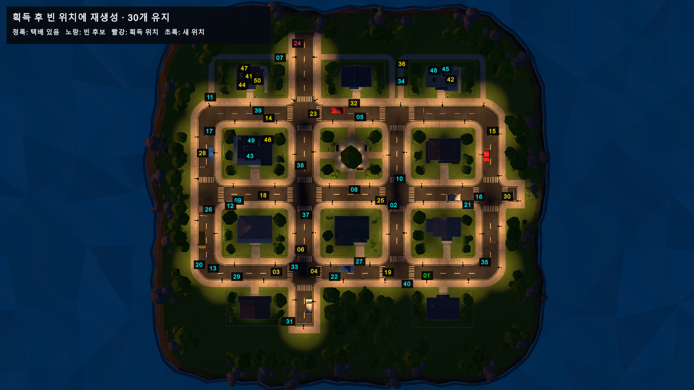
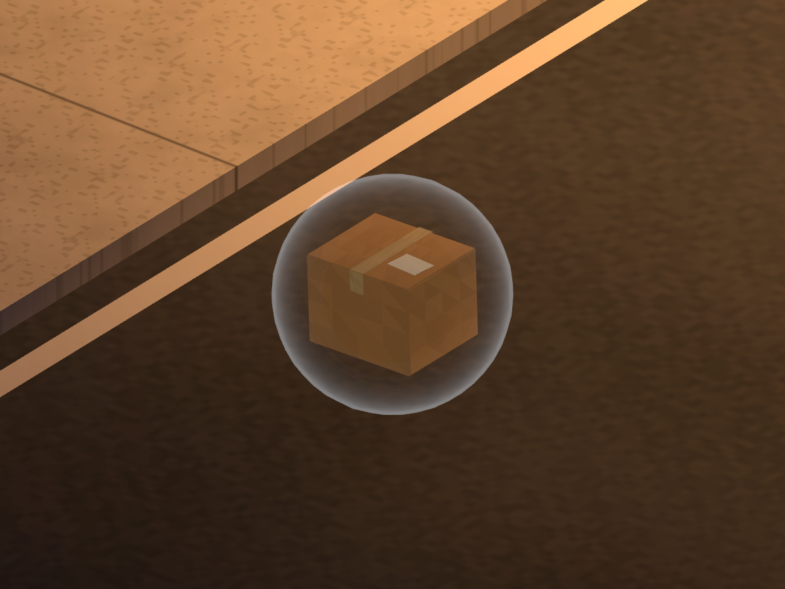
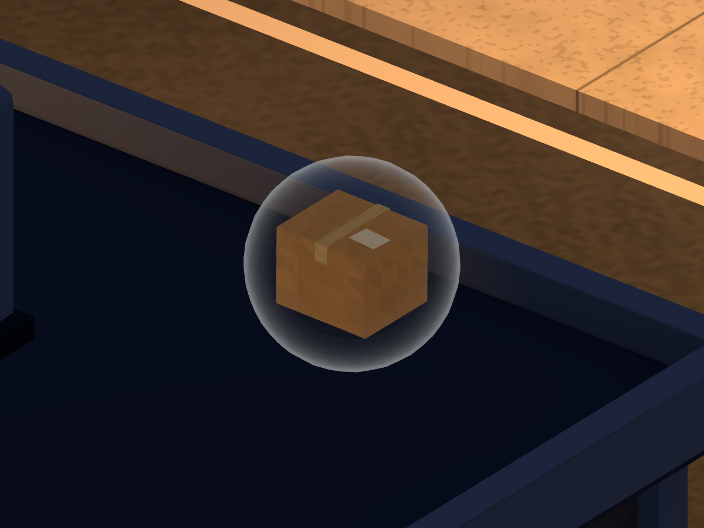
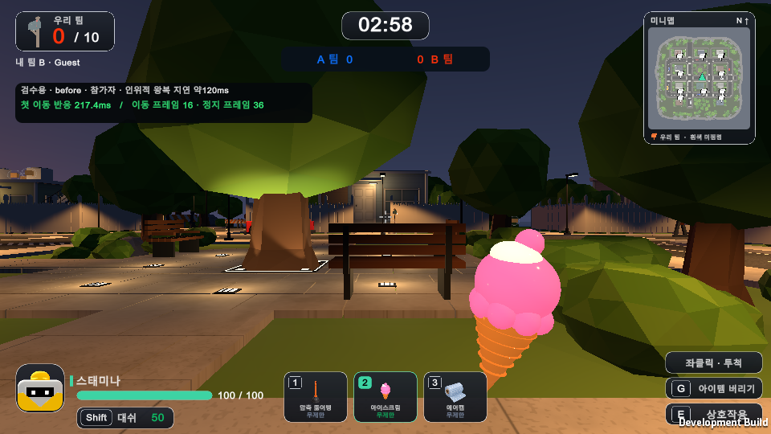
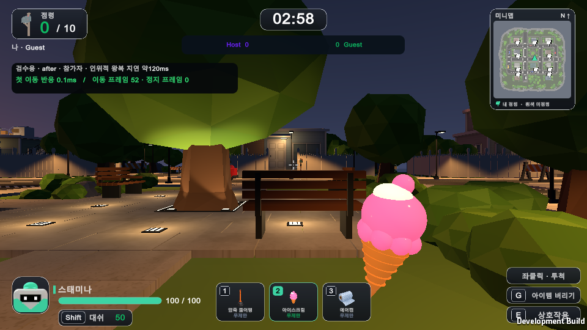
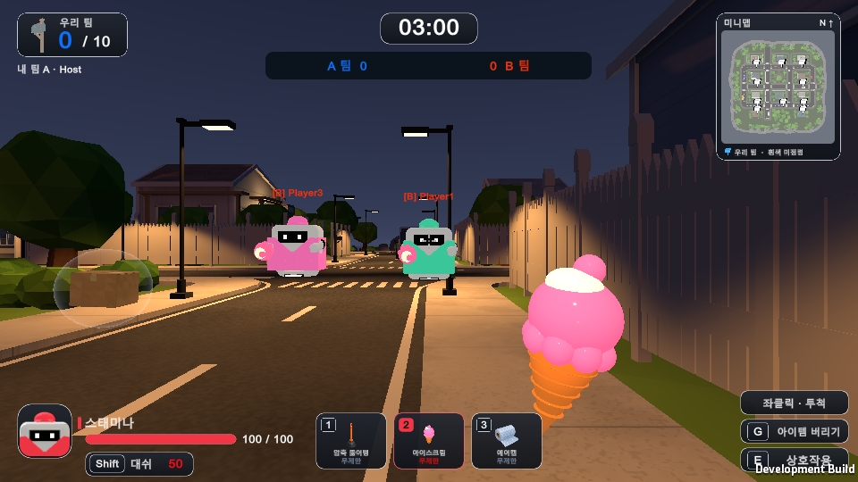
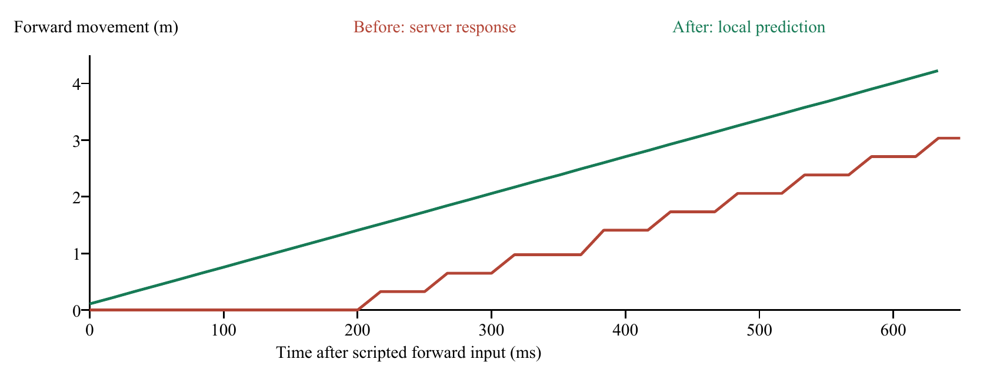
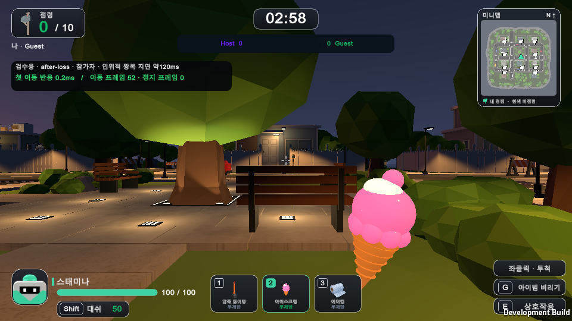

# 택배 무작위 배치와 재생성 변경 기록

2026-10-16 · 사례 01·02·03 · R01~R10 · 요구 변경 · 구현 및 개발 환경 검증 완료

이전 기록: [2026-10-15 멀티플레이 사례02](../20261015/README.md)

## 결과

택배 후보 위치를 50곳으로 지정하고 경기 시작 때 중복 없는 30곳을 무작위로 선택한다. 한 개를 먹으면 잠시 29개가 된 뒤 같은 프레임의 LateUpdate에서 다른 빈 위치에 보충해 30개를 유지한다. 바깥 풀밭을 포함한 GrassBase 표면은 후보에서 제외했다. 새 Windows 실행 파일의 1대1과 2대2에서 재생성 위치 동기화까지 확인했다.

## 문제와 원인

기존에는 SampleScene에 택배 10개가 저장되어 있었고, FloatingParcel.TryCollect는 획득한 오브젝트를 비활성화하는 것으로 끝났다. 경기 재시작 시 10개를 다시 켰지만, 경기 중 다른 위치에 보충하는 처리는 없었다. 기존 배치 도구도 풀밭을 허용했다. 이번 요청은 후보 약 50곳·활성 30개·획득 후 빈 위치 보충·바깥 풀밭 제외다.

## 구현

ParcelSpawnPool에 저장된 Transform 후보 50개와 기존 프리팹으로 만든 택배 30개를 연결했다. 시작 배치는 부분 Fisher–Yates 추첨으로 중복을 막는다. 획득 즉시 슬롯을 비우고 오브젝트·상호작용을 끈다. LateUpdate에서 사용 중인 슬롯과 방금 먹은 슬롯을 제외한 후보를 뽑아 같은 오브젝트를 재사용한다. 별도 리스폰 지연은 추가하지 않았다. 여러 플레이어의 같은 프레임 획득도 모아서 보충한다.

후보는 도로·보도 40곳과 기존 계단으로 접근 가능한 평평한 옥상 10곳이다. 풀밭·나무·장애물·기울어진 지붕·계단 없는 지붕을 거르고, 택배 발판의 아홉 지점 지지와 상자/플레이어 공간 및 후보 간 최소 4m를 검사했다. 좌표는 장면의 Layer_12_TestParcelDrops/SpawnPoints에 저장되어 직접 조정할 수 있다.

위치 추첨과 아이템 지급은 호스트가 처리한다. 스냅샷의 기존 택배 활성 여부 배열을 30개 모델 각각의 후보 번호 배열로 바꿔, 클라이언트가 같은 위치·활성 상태를 적용한다. 중복되거나 범위를 벗어난 배열은 전체 적용 전에 거부한다. 초기화와 재경기에는 30곳을 다시 추첨한다. 메시지 형식이 바뀌어 NGO ProtocolVersion을 2로 올렸으므로 모든 참가자가 이번 새 실행 파일을 사용해야 한다.

| 항목 | 최종값 |
|---|---|
| 저장 후보 | 50곳 / 도로·보도 40곳 + 접근 가능한 평평한 옥상 10곳 |
| 경기 시작 | 중복 없는 무작위 30곳에 활성 택배 30개 |
| 획득 후 | 29개 → 같은 프레임 LateUpdate에서 다른 빈 위치에 보충 → 30개 |
| 금지 위치 | GrassBase 풀밭 전체 / 장애물·지원 없는 발판·접근 불가 지붕 |
| 배치 안전 | 후보 간 최소 4m / 발판 아홉 점과 여유 공간 검사 |
| 멀티플레이 | 호스트가 위치 결정 / 모든 클라이언트에 같은 후보 번호 전달 |

## 실제 화면

상공 화면은 실제 Unity Game View에 후보 번호와 점유 상태를 표시한 검수용 재현이다. 번호·상태 색은 검수용이며 일반 게임에는 나오지 않는다. 활성은 청록, 빈 후보는 노랑, 획득 위치는 빨강, 새 위치는 초록이다. 2026-10-16 촬영했다. 도로와 옥상 근접 화면도 같은 날 네이티브 카메라로 촬영했다.

50개 후보와 활성 30개의 실제 상공 검수 화면

획득 위치는 빨강 새 보충 위치는 초록으로 표시한 실제 재생성

도로의 실제 부유 택배와 보호막

접근 가능한 평평한 옥상의 실제 부유 택배

## 실행 검증

2026-10-16 Unity 6000.5.10f1 SampleScene에서 배치 51개, 풀 동작 19개, 기존 랜덤 획득 48개, 기존 상호작용 43개 검사를 실행했다. 풀 검사 안에는 200회 새 판과 1,000회 실제 TryCollect/Refill 반복, 5개/30개 동시 획득, 중복 지급 방지, 모델 재사용 및 실제 LateUpdate 자동 보충이 포함된다. 반복 횟수를 독립 검사 개수로 합산하지 않는다. 최종 EXE 실제 2프로세스는 호스트 17개/클라이언트 5개, 4프로세스는 호스트 18개/클라이언트 각각 5개가 통과했다.

- 후보 배치 검사: 51개 통과. [로그](evidence/parcel-layout-check.txt)

- 리스폰 풀 검사: 19개 통과. [로그](evidence/parcel-respawn-check.txt)

- 랜덤 아이템 획득 회귀: 48개 통과. [로그](evidence/parcel-loot-check.txt)

- 부유·E 상호작용 회귀: 43개 통과. [로그](evidence/floating-interaction-check.txt)

- 최종 EXE 1대1: 호스트 17 / 클라이언트 5 통과. [로그](evidence/network/1v1/host-checks.txt)

- 최종 EXE 2대2: 호스트 18 / 클라이언트 각 5 통과. [로그](evidence/network/2v2/host-checks.txt)

- 실행 메뉴: Tools/Gameplay/Test Parcels/Build 50 Spawn Points, Verify Spawn Layout, Verify Respawn Pool, Verify Random Loot, Verify Floating Interaction.

- 네트워크: 최종 EXE에 -delivery-host [-delivery-mode 1v1] / -delivery-join 127.0.0.1 / -delivery-proof 인자를 전달해 실제 프로세스를 연결했다. 입력·위치·점령 및 종료 시간 일부를 검수용으로 설정한 자동 시나리오다.

## 재시도

새 스크립트 추가 직후에는 에셋 강제 새로 고침 전 타입을 찾지 못하는 컴파일 메시지가 있었고 전체 Refresh 후 해소됐다. 기존 획득 검사는 공개 NetworkScreens 필드를 찾지 못하던 검사 플래그와 고정 접근 방향/예전 카메라 높이 때문에 실패했다. 검사 도구를 현재 필드와 실제 눈높이·장애물 없는 접근 방향에 맞춰 수정한 뒤 48개/43개가 통과했다. 첫 상공 캡처는 장착 아이스크림 카메라가 일부 후보를 가려, 검수 중 장착 카메라를 숨기고 다시 촬영했다.

## 빌드와 제한

Windows x64 Mono Development LZ4 빌드 성공, 약 263.32MB·23.40초. 기존 com.unity.pipeline의 CodeAnalysis Unsafe DLL 경로 예외 1개와 기존 Minimap 검색 API 경고 2개는 빌드 진단에 남아 있다. 게임 코드 컴파일과 실제 배포 EXE 실행 통과와 구분해 기록한다. 동일 PC의 다중 프로세스 검증이며 서로 다른 물리 PC·Tailscale/WAN 연결은 이번 검증에 포함하지 않았다.

## 수정 파일

- Assets/Gameplay/ParcelSpawnPool.cs

- Assets/Gameplay/FloatingParcel.cs

- Assets/Gameplay/MonsterDeliveryPrototype.cs

- Assets/Gameplay/DeliveryNetwork.cs

- Assets/Gameplay/DeliveryNetworkProof.cs

- Assets/Editor/ParcelSpawnSetup.cs

- Assets/Editor/ParcelSpawnCheck.cs

- Assets/Editor/TestParcelDrops.cs

- Assets/Editor/ParcelLootCheck.cs

- Assets/Editor/FloatingParcelCheck.cs

- Assets/Scenes/SampleScene.unity

## 전달본

새 실행 패키지는 MonsterDeliveryService_20261016.zip이다. 전체 압축 해제 후 실행하며, 참가자 전원 같은 새 버전을 사용한다. Tailscale 접속 방법은 기존과 같다.

[Word 보고서](ChangeReport_20261016.docx) · [열람본](index.html) · [요청 대조표](requests.csv)

## 통합 인수인계와 커밋 정리

2026-10-16 후속 요청에 따라 [NEXT_SESSION.txt](../../../NEXT_SESSION.txt) 맨 위에 현재 9종 아이템, 1대1/2대2, 택배50곳/활성30개, 실행 검수 근거, 최신 전달물의 실제 경로, 직접 IPv4/Tailscale 테스트 계획, 미구현 범위를 통합했다. TEAM_STATUS에도 이 진입점을 연결했다. 지금까지 누적된 구현·에셋·검사·캡처·보고서를 로컬 커밋 대상으로 정리했으며 원격 푸시는 요청받지 않았다. 이 후속 변경은 문서만 수정하므로 가이드에 따라 Word 재출력과 게임 재검사는 생략하고 링크·파일 경로·Git 변경 범위를 확인했다.

<!-- CASE02_UI_NETWORK -->

## 사례 02 참가자 지연과 개인전 UI 수정

2026-10-16 · R05~R09 · 결함 수정 및 요구 변경 · 검증 완료

내 로봇 초상화를 배정된 옷색에 맞추고, 1대1의 팀 문구와 A/B 점수 표시를 개인 점령과 플레이어 이름으로 바꿨다. 참가자의 서버 응답 대기 이동을 재현하고 로컬 예측과 서버 확인 후 보정을 적용했다. 같은 인위적 지연 조건에서 첫 이동이 약217ms 대기에서 입력을 처리한 같은 프레임으로 바뀌었다. 2대2의 팀 표시는 유지한다.

### 문제와 원인

초상화는 노란 옷으로 한 번 렌더한 robot_portrait PNG를 항상 흰색 틴트로 그렸다. 실제 플레이어의 자동 배정 색과 연결되지 않아, 월드 로봇과 스태미나 색이 바뀌어도 얼굴 아이콘의 옷은 노란색으로 남았다. 팀 문구도 경기 인원 구분 없이 Network Playing 여부만 확인했다.

이동 경로를 추적하면 방장은 입력을 매 프레임 직접 처리하지만 참가자는 약20Hz로 입력을 보내고, 서버가 돌려준 위치를 수신할 때만 자기 CharacterController를 옮겼다. 50ms 전송 간격과 양방향 통신 대기, 스냅샷 갱신 간격이 합쳐져 입력 반응이 늦고 위치가 계단식으로 움직였다.

수정 전 일반 창으로 같은 PC의 실제 EXE 두 개를 연결하고, 입력과 위치 메시지 송신에 각각60ms 지연을 넣었다. 자동 전진 입력 후 참가자의 첫 이동은217.40ms, 방장은0.40ms였다. 참가자는 측정 구간83프레임 중57프레임에 같은 위치를 유지했다. 양쪽 프레임 시간은 약16.7ms여서 이 재현에서는 그래픽 프레임 부족보다 이동 동기화 대기가 원인으로 확인됐다.

위치 메시지도 ReliableFragmentedSequenced를 사용했다. 오래된 위치의 재전송을 기다릴 수 있는 추가 위험이 있는 구조다. 이번 수정 전 검사는 실제 전송 계층의 패킷 손실을 만들지는 않았으므로, 해당 재전송이 사용자가 겪은 지연을 얼마나 키웠는지는 미측정으로 구분한다.

### 확인 과정과 측정 범위

측정은2026-10-16, 같은 PC의 Windows 네이티브 게임2개, D3D11 일반 창,960×540, 목표60fps 조건이다. 양방향 송신에60ms씩 지연을 넣었으며 실제 WAN 측정이 아니다. 첫 반응은 자동 입력 할당부터 로컬 물리 위치 변경까지의 앱 내부 시간이다. 하드웨어 입력부터 화면 표시까지의 시간이나 ping이 아니다. 같은 프레임 반영은60fps에서 다음 표시 프레임 약16.7ms 안에 보이는 범위로 해석한다.

| 측정 항목 | 수정 전 | 수정 후 |
|---|---|---|
| 참가자 첫 로컬 이동 | 217.40ms | 같은 프레임 0.13ms |
| 전진 중 위치 정지 프레임 | 57 / 83 | 0 / 83 |
| 참가자 평균 프레임 시간 | 16.71ms | 16.71ms |
| 방장 누적 송신 페이로드 | 750,342바이트 | 132,314바이트 |

### 수정 방법

서버 이동 계산을 SimulateNetMovement로 분리해 참가자도 같은 충돌·중력·웅크리기·대쉬 계산을60Hz로 먼저 실행한다. 입력에 순번을 붙이고, 서버가 확인한 순번까지 이력에서 지운 뒤 아직 확인되지 않은 입력만 다시 적용한다. 서버가 최종 위치·아이템·피격·점령을 계속 결정한다. 강제 이동 중에는 일반 로컬 이동 예측을 제한한다.

입력과 상태 전송은30Hz로 바꿨다. 확인 전 최근 입력을 묶어 재전송하고 중복 순번은 한 번만 처리한다. 프레임 순번은 방 수명 동안 증가시켜 오래된 상태를 거부하고, 다른 플레이어의 위치·회전은 프레임 사이에서 보간한다. 입력 이력·큐·처리 시간에는 상한을 둔다.

입력·스냅샷 JSON은 기본 제공 UTF8/Deflate로 압축한다. 압축 결과1,100바이트 이하는 UnreliableSequenced로 보내 최신 상태를 우선한다. 이보다 큰 데이터는 기존 신뢰성 있는 분할 전송으로 보낸다. 수신 압축 크기와64KiB 해제 크기를 제한했다. 색·우체통·택배는 상태가 바뀔 때만 다시 적용해 불필요한 갱신도 줄였다.

기존 네이티브 아이콘 렌더 도구로 자동 배정 색6종의 로봇 PNG를 만들고 배정 번호로 선택한다. 1대1은 점령/내 점령/플레이어 이름과 개인 색을 사용하고, 2대2는 우리 팀/A 팀/B 팀과 팀 점령색을 사용한다. 메시지 형식 변경을 구분하기 위해 NGO ProtocolVersion을3으로 올렸다.

### 실제 화면

2026-10-16 수정 전 실제 참가자 화면. 노란 고정 초상화와 팀 문구, 인위적 지연 검수용 패널이 보인다. 패널 수치는 촬영 시점의 진행 중 값이다.

2026-10-16 최종 수정 후 실제 참가자 화면. 배정된 초록 초상화, 개인 점령 문구, Host와 Guest 이름, 같은 프레임 반응을 확인했다.

2026-10-16 최종 EXE4개를 연결한 실제2대2 검수. 방장 초상화는 배정된 빨강, 점수는 팀 기준으로 유지된다.

프레임별 실제 CSV의 이동 거리 비교

송신 앱 메시지20% 누락을 추가한 실제 참가자 검수 화면

### 수정 후 검증

수정 후 참가자 화면은 초록 옷 배정과 같은 초록 초상화를 보인다. 왼쪽 위는 점령, 왼쪽 이름은 나 · Guest, 미니맵은 내 점령, 위 가운데는 Host와 Guest다. 2대2 검수에서는 빨간 옷 방장의 초상화가 빨강이고 A/B 팀 점수가 유지된다. 화면의 검수용 측정 패널은 실행 인자로 켠 개발 검사에만 나타난다.

추가 검사에서는 같은 지연 조건에서 송신 앱 메시지를 매5번째마다 누락했다. 실제 전송 계층 손실을 만든 검사는 아니다. 참가자 메시지32개를 의도적으로 누락한 상태에서도 전진 구간83프레임이 모두 움직였고, 정지 후 로컬 위치와 마지막 서버 확인 위치가 일치했다. 확인 전 입력은 다시 보내고 서버는 중복을 제거했다. 판정·상태 변화까지 네트워크 지연이 없어졌다는 의미는 아니다.

- Editor 예측과 HUD: 18개 통과 · 입력 순번/확인 후 재적용/새 판 순번/색6종/개인전·팀전/압축 한도

- 택배 풀 회귀: 기존19개 재실행 통과 · 결과와 재촬영본은 별도 이름으로 보존

- 최종 EXE 1대1: 호스트17 / 참가자5 통과

- 최종 EXE 2대2: 호스트18 / 참가자 각5 통과

- 지연과 메시지 누락: 첫 이동 반응/전진 중 정지 프레임/정지 후 위치 수렴 확인

### 재시도

첫 숨김 창 캡처는 검게 나와 D3D11 일반 창으로 다시 촬영했다. CompressionLevel 이름 충돌은 전체 네임스페이스를 지정해 컴파일을 복구했다. 첫 수정본은 라운드에서 메시지 순번까지 초기화해 참가자 경기 진입이 늦어졌고 측정 저장 전에 방장이 종료됐다. 새 방에서만 순번을 초기화하도록 수정하고 재경기 순번 검사와 최종 양측 결과 저장으로 재검증했다. 실패 로그와 첫 화면은 삭제하지 않고 evidence/latency에 보존했다.

### 빌드와 적용

최종 Windows x64 Mono Development LZ4 빌드 성공, 약263.39MB/13.57초. 기존 UnityPipeline CodeAnalysis Unsafe DLL 경로 진단1개와 Minimap 구형 API 경고2개는 그대로 기록했다. 이번 게임 코드의 컴파일 및 최종 EXE2개·4개 실행 검사는 통과했다.

MonsterDeliveryService_20261016_UI_NetworkFix.zip을 전체 압축 해제해 실행한다. 모든 참가자가 이 새 패키지를 사용해야 한다. Protocol3이며 이전 Protocol2와 혼용하지 않는다. EXE·Data·MonoBleedingEdge·DLL을 함께 유지한다. Test_1v1.cmd/Test_2v2.cmd를 포함한다.

### 남은 제한

서로 다른 물리 PC·실제 LAN/Tailscale/WAN의 프레임 시간과 지연은 아직 실측하지 않았다. 사용자의 실제 환경에서 추가 요인이 남는지는 새 버전 연결로 확인해야 한다.9종 전체 온라인 조합·장시간 고손실·재접속 복구·호스트 이전은 이번 검수 완료 범위가 아니다. 큰 스냅샷은 신뢰성 있는 분할 전송을 계속 사용한다.

### 근거와 소스

- [측정 요약과 자동 비교](evidence/latency-comparison.json)

- [수정 전 참가자 실제 프레임 CSV](evidence/latency/before-visible/client-1-before.csv)

- [수정 후 참가자 실제 프레임 CSV](evidence/latency/after-final/client-1-after.csv)

- [메시지20% 누락 결과](evidence/latency/after-loss/client-1-after-loss.json)

- [Editor18개 검사](evidence/prediction-hud-check.txt)

- [택배19개 재실행](evidence/parcel-respawn-ui-recheck.txt)

- [최종1대1 호스트](evidence/network-ui-fix/1v1/host.json)

- [최종2대2 호스트](evidence/network-ui-fix/2v2/host.json)

- [실패와 재시도](evidence/ui-network-retries.txt)

- [사용자가 제공한 수정 전 화면](images/20261016_user_report_ui_before.png)

- [보고서 편집 원문](source/report_data.json)

- `Assets/Gameplay/DeliveryNetwork.cs`

- `Assets/Gameplay/DeliveryNetworkPrediction.cs`

- `Assets/Gameplay/DeliveryNetworkLatencyProof.cs`

- `Assets/Gameplay/DeliveryNetworkGameplay.cs`

- `Assets/Gameplay/DeliveryNetworkUI.cs`

- `Assets/Gameplay/DeliveryRobotVisual.cs`

- `Assets/Gameplay/MonsterDeliveryHUD.cs`

- `Assets/Gameplay/ParcelSpawnPool.cs`

- `Assets/Gameplay/PlungerCombat.cs`

- `Assets/Editor/InGameUISetup.cs`

- `Assets/Editor/DeliveryNetworkCheck.cs`

- `Assets/Resources/UI/InGame/robot_portrait_0.png ～ robot_portrait_5.png`

<!-- CASE03_MACOS -->

## 사례 03 맥 개발 테스트 패키지

2026-10-16 · R10 · 요구 변경 · 패키징 완료 및 실기 미검증

진행 중이던 개인전 UI와 참가자 이동 지연 수정을 마무리하고, 같은 게임 소스로 Intel과 Apple Silicon을 지원하는 맥 패키지를 추가했다. Windows 검수 결과는 사례02에 보존했다. 맥 패키지는 파일 검증까지 완료했고 실제 맥 실행은 미검증이다.

### 원인과 방법

설치된 Unity 6000.5.10f1에 정확히 맞는 공식 Mac Mono 모듈을 추가했다. Unity 서명과 배포 매니페스트 MD5를 확인한 설치 파일만 사용했다. SampleScene을 Universal x86_64·arm64, Mono 일반 빌드, LZ4로 빌드했다. 게임 코드 변경은 없으며 네트워크 버전은 Windows와 같은 Protocol3이다.

### 검증 결과

최종 Unity 빌드 성공: 55.92초, 201.17MB. Info.plist의 최소 OS는 macOS 12.0이다. 실행 파일과 네이티브 라이브러리 6개 모두 두 CPU 아키텍처를 확인했다. 앱 데이터·관리 코드 포함, ZIP CRC와 Mach-O 및 .command의 UNIX 실행 권한을 검증했다. ZIP 크기는 110.9MiB다.

### 실행과 연결

맥에서 ZIP 전체를 풀고 MonsterDeliveryService.app을 실행한다. Test_1v1.command와 Test_2v2.command는 한 맥에서 각각2개·4개 창을 연다. 다른 PC 접속은 방장 IPv4 또는 방 코드 방식이다. 참가자 전원이 Protocol3 최신 패키지를 사용한다. Windows 패키지는 기존 UI_NetworkFix 검수본을 그대로 제공한다.

### 재시도

첫 시도는 플랫폼 전환 중 컴파일로 중단됐다. 모듈 설치 후에는 도구가 성공으로 표시해도 실제 앱이 없어 배포에서 제외했다. 저장된 Editor를 정상 재시작해 모듈을 로드했다. 이후 Development 빌드의 Burst dSYM 생성이 경로 누락으로 실패했다. 디버그 심볼을 생성하지 않는 일반 빌드로 다시 만들어 실제 앱을 검사했다. 이전 실패와 최종 결과를 진단 파일에 구분했다.

### 남은 제한

실제 맥에서의 첫 실행·키 입력·프레임·멀티플레이, Windows↔Mac 연결은 이 Windows 환경에서 확인하지 않았다. 맥 플레이 화면 캡처도 없으며 Windows 캡처를 맥 검증으로 대신하지 않았다. Apple Developer ID 서명과 공증은 수행하지 않아 첫 실행 시 macOS 확인이 필요할 수 있다. 일반 빌드에는 개발용 자동 지연 재현·진단 오버레이가 포함되지 않는다. 기존 UnityPipeline 누락 DLL 진단은 빌드 환경 문제로 따로 기록했다.

### 근거

- [빌드 결과](evidence/build-macos.json)

- [앱 구조와 ZIP 검사](evidence/package-verification-macos.json)

- [진단과 재시도](evidence/macos-build-diagnostics.txt)

- [재생성 원문](source/report_data.json)
