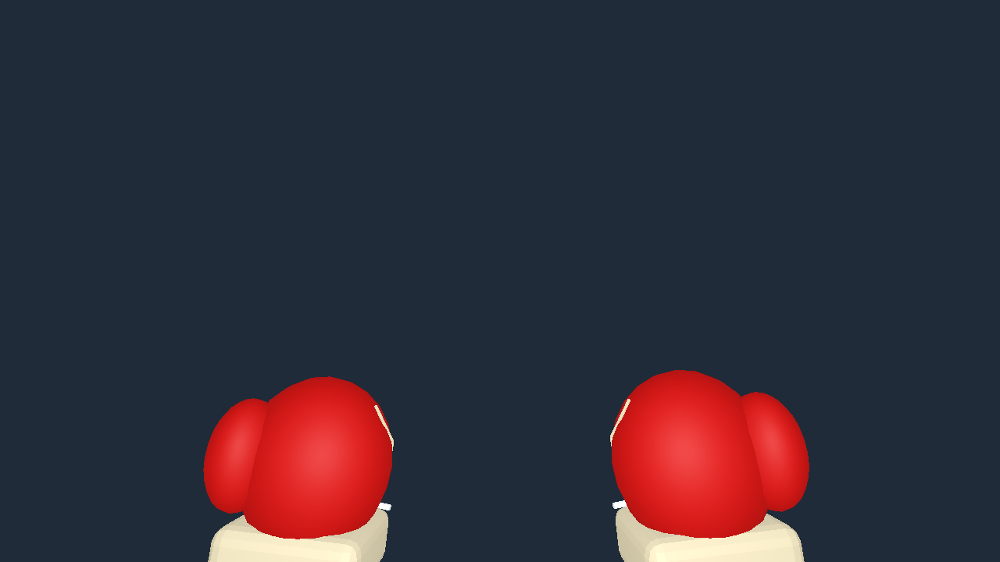
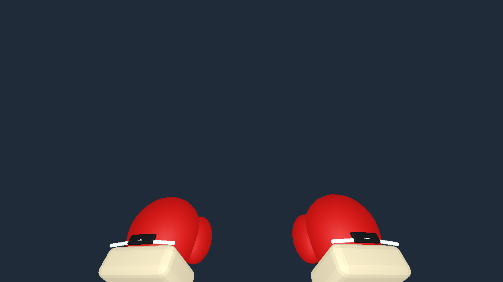
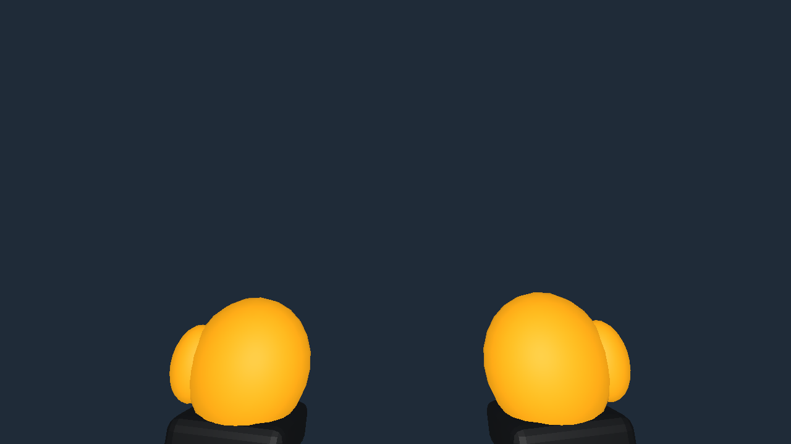
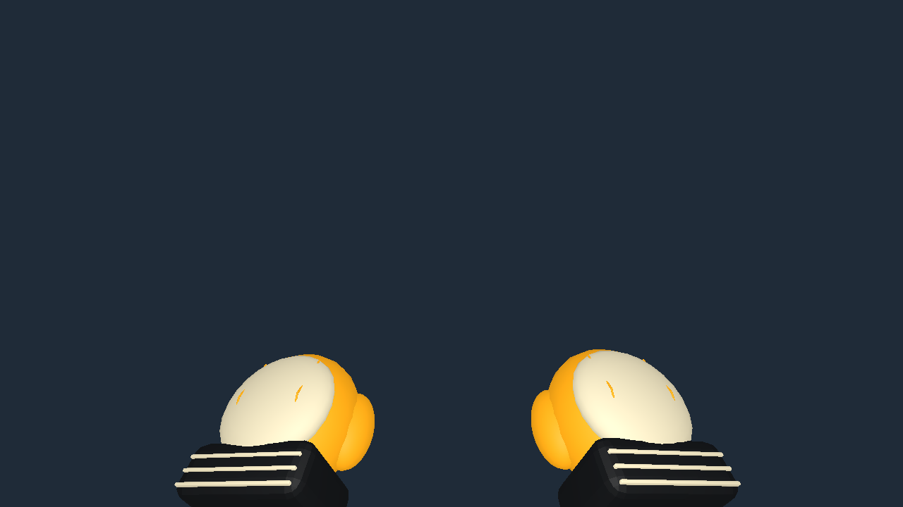
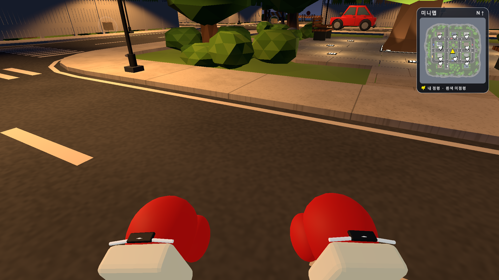
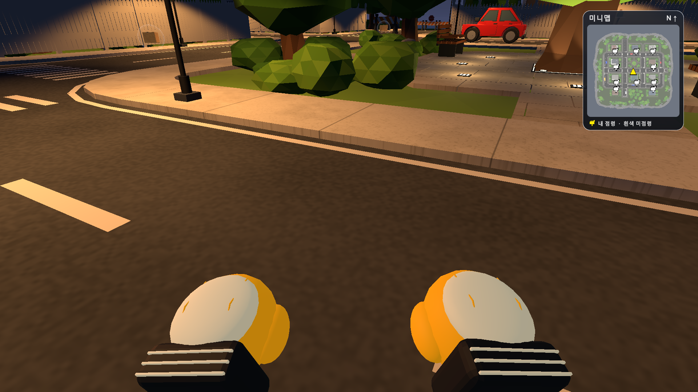

# 복싱 글러브·작업용 장갑 회전 버그 수정 보고서

요청·재현: 2026-10-17 / 수정 후 검증·작성: 2026-10-18 (한국 시간) · Monster Delivery Service · 사례01

관련 요청: R01, R02, R03 · 사례01 · 버그 수정 · 상태: Editor/Play 재현 해결 완료

## 요약

Unity 6000.5.10f1의 MonsterDeliveryService 연결을 확인했다. 두 장갑의 공통 1인칭 자세 처리에서 회전이 누적되는 원인을 수정했다. 수정 전 최대 179.90350도였던 회전 오차가 수정 후 0.00000도로 측정됐다.

## 문제와 기대 동작

복싱 글러브와 작업용 장갑이 장착 중 계속 뱅글뱅글 돈다. 기대 동작은 장갑이 카메라를 따라 일정한 준비 자세를 유지하고, 복싱 동작 뒤 원래 자세로 돌아오는 것이다. 온라인에서 아이템을 장착하면 LateUpdate → PoseNetworkPlayers → heldItem.FirstPerson()이 매 프레임 호출된다.

## 원인

DeliveryHeldItem.FirstPerson()은 처음 자세를 맞출 때 현재 part.rotation에 안쪽 각도(좌우 12도, 기울기 7도)를 곱한다. 호출할 때마다 같은 회전 보정을 다시 곱하지만, 자식 장갑의 원래 회전은 초기화하지 않는다. 반복 호출로 보정이 누적된다. 두 프리팹 모두 paired=true이므로 동일한 원인이 적용된다. 수정 전 실제 Unity 프리팹에서 각각 600회 호출해 최대 179.90350도 회전을 재현했다. 위치 변화는 0m였다.

## 사용한 방법

Assets/Gameplay/DeliveryHeldItem.cs의 FirstPerson()에 viewPoseInitialized 상태를 추가했다. 첫 호출에서는 기존 보정 및 right/leftViewPosition·Rotation 저장을 그대로 수행한다. 이후 호출은 보정을 다시 더하지 않고 기존 PushFirstPerson(0, true)로 저장된 카메라 기준 자세를 복원한다. 루트 위치·회전·스케일 설정은 매번 수행한다. 보정 횟수가 매 호출 1회에서 인스턴스당 최초 1회로 바뀌었다. FirstPerson()의 전체 호출 위치를 검색했고, 네트워크 표시·장착·투척 복원은 같은 공통 함수를 사용한다. 단일 모델은 기존 paired=false 반환을 유지한다. 프리팹 수치와 공격·점령 효과 수치는 변경하지 않았다.

## 해결 결과

Editor 검사에서 두 장갑 각각 600회 자세 갱신의 최대 회전 변화가 0.00000도, 위치 변화가 0.000000m였다. 카메라 yaw/pitch/roll 변경, 오른손·왼손 단독 전진 및 원위치 복귀를 포함한 12개 검사가 통과했다. SampleScene Play Mode에서는 실제 PoseNetworkPlayers를 장갑별 180 렌더 프레임 호출해 각각 회전 변화 0.00000도를 확인했다. 각 장갑의 3인칭↔1인칭 표시 재생성도 예외 없이 통과했다(Play 검사 4항목).

## 확인 근거

2026-10-17 23:59:34+09:00 수정 전 기록, 2026-10-18 00:00:01+09:00 수정 후 Editor 검사, 00:01:12+09:00 시작 Play 검사. Unity 6000.5.10f1, SampleScene. 컴파일 후 Console 오류 조회에서 게임 코드 컴파일 오류는 없었다. 기존 구형 FindObjects API 경고는 남아 있다. 즉석 execute_code 검사는 UnityPipeline의 Unsafe DLL 메타데이터 오류로 실패했으므로 성공 근거에서 제외했고, 정상 컴파일되는 Editor 메뉴 검사로 대체했다. 첫 메뉴 호출은 리로드 전 등록되지 않아 실패했고 Refresh 후 재실행했다.

## 캡처 설명

프리팹 비교는 Unity Editor의 격리된 Preview Scene에서 실제 카메라로 렌더했다. 수정 전은 2026-10-17, 수정 후는 2026-10-18 촬영했다. 파일명의 20261017은 요청 시작일이며 수정 후 실제 촬영일은 10월18일이다. 게임 캡처는 별도로 20261018 파일명으로 보존했다. 생성 이미지나 재구성 화면은 사용하지 않았다.

## 재실행과 로그

Tools/Gameplay/Gloves/Verify Stable Rotation: Editor 12항목 통과.
Tools/Gameplay/Gloves/Verify Rotation In Play: Play Mode 필요, 실제 표시 경로 4항목 통과. 게임 상태를 검수용으로 바꾸므로 새 Play 세션에서 실행하고 종료한다.
evidence/rotation-before.txt, rotation-after.txt, rotation-play.txt에 시각·수치·검사 결과 보존.
검사 원문: Assets/Editor/GloveRotationCheck.cs. 수정 전/후 게임 코드와 diff는 source 및 evidence에 보존.

## 남은 제한

확인 완료 범위는 두 장갑의 공통 자세 처리와 로컬에서 재현한 실제 온라인 표시 경로다. 다른 PC의 호스트·참가자 실접속, 장시간 온라인 경기, 공격 적중·점령 효과의 전체 회귀는 이번에 실행하지 않았다. 기존 GloveEffectsCheck는 과거 시작 장비 전제를 포함하므로 이번 통과 수에 넣지 않았다. 기존 배포 EXE·Mac 앱은 재빌드하지 않았으므로 이번 수정은 Unity 프로젝트 소스에 적용되어 있다. 테스트 뒤 Play Mode를 종료했다. 재현 검사 메뉴는 프로젝트에 남겼다.

## 보고서와 근거 링크

[Word 보고서](ChangeReport_20261017.docx) · [열람본](index.html) · [요청 대조표](requests.csv) · [수정 전 로그](evidence/rotation-before.txt) · [수정 후 로그](evidence/rotation-after.txt) · [Play 로그](evidence/rotation-play.txt) · [문서 검수](evidence/document-qa.json) · [편집 원문](source/report_data.json)
