# 구명조끼 무적 이펙트와 현재 아이템 연출

2026년 10월 20일

## 문제와 원인

구명조끼를 획득하면 손 모델이 표시됐고, 사용 중 전용 보호 오라는 없었다. 기존에는 5초간 새 방해 효과를 차단하는 판정과 조끼 몸 모델 및 면역 HUD가 구현돼 있었다. 사용자의 요청은 손 표시를 없애고 무적 이펙트를 추가하며 현재 무기별 이펙트를 자료실에 정리하는 것이다.

## 수정 방법

공통 HasHeldModel에서 구명조끼를 제외해 본인 1인칭·3인칭 및 네트워크 상대의 손 모델과 손에 든 자세에 동일하게 적용했다. 기존 immuneUntil 잔여 시간을 따라 금빛 보호 링 3개와 움직이는 반짝임 8개를 표시한다. 본인 1인칭에서는 몸 오라를 숨기고 기존 가장자리 텍스처를 재사용한 금빛 화면과 무적 남은 시간 HUD를 표시한다. 소모 후 슬롯이 비워져도 면역 상태에 따라 이펙트가 지속된다. 기존 5초 판정과 면역 스냅샷 및 프로토콜13은 유지했다.

## 검증 결과

2026년 10월 20일 Unity 6000.5.10f1 SampleScene 실제 Editor Play에서 LifeJacketCheck의 15항목이 모두 통과했다. 손 모델 숨김, 정상 사용 1회 소모와 5초 면역, 넉백·상승·기절·감속·잉크 및 비방어형 영역 차단, 에어캡 미소모, 오라 구성·충돌 없음·중복 방지, 슬롯 소진 뒤 지속, 실제 시간 만료와 피격 복귀, 3인칭 본인 표시 및 경기 종료 숨김을 검사했다. 검사 후 Console 오류0. 다른13종은 이번 전체 회귀 검증이 아니라 소스 확인과 기존 구현 정리다.

## 화면과 근거

이미지는 실제 Unity 화면이다. 상대 캡처는 검수용 위치와 카메라를 설정한 재현이며 자연 발생 멀티 경기 화면이 아니다. 본인 캡처는 공원 테스트 행에서 실제 사용·HUD를 촬영했다. 실행 근거는 evidence/lifejacket-play.txt, 메뉴는 Tools/Gameplay/Special Delivery/Verify Life Jacket이다.

## 재시도

첫 scripts refresh에서 새 이펙트 파일 임포트 전 CS0246이 발생해 전체 Asset refresh 후 컴파일 오류0을 확인했다. execute_code 경로는 기존 UnityPipeline Unsafe DLL 메타데이터 문제로 실패해 정식 Editor 메뉴를 사용했다. 첫 본인 캡처는 비활성 검사 상태로 HUD가 없어서 폐기하고 정상 활성 게임 캡처로 교체했다. 사이트 공식 build helper는 npm-cli 경로 문제로 실패해 기존 run-framework.mjs build를 직접 실행했다.

## 확인 범위

별도 네트워크 두 프로세스·WAN·4인전 및 배포 실행 파일 재빌드는 이번에 수행하지 않았다. 네트워크 손 표시는 공통 함수, 보호 연출은 기존 복제 면역 시간을 재사용하지만 이번 별도 참가자 실행으로 검증했다고 주장하지 않는다. 기존에 걸린 방해 효과를 정화하지 않으며 체력·사망 체계는 추가하지 않았다. 문서 및 사이트 배포 상태는 별도 기록한다.

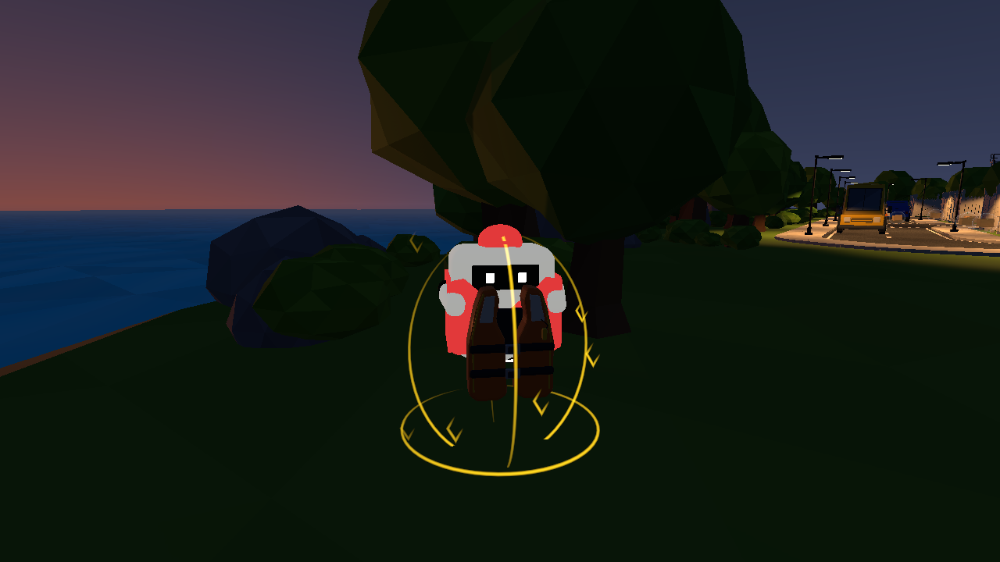

상대의 금빛 보호 링과 반짝임

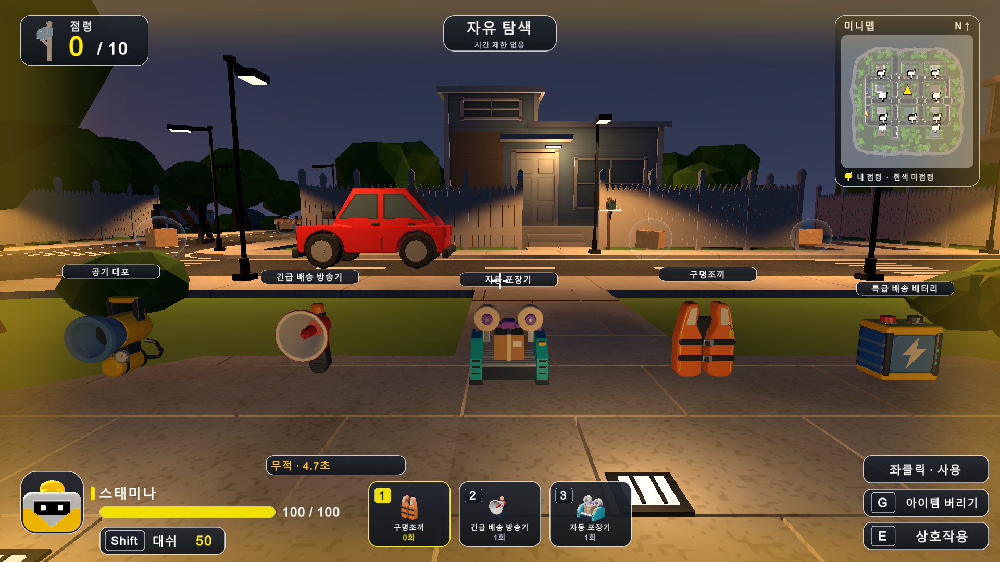

본인 화면 무적 가장자리와 남은 시간

[실행 검사](evidence/lifejacket-play.txt) · [현재14종 이펙트](ItemEffects_20261020.md)

추가 회귀 검사: 2026-10-20 공원5종 검사45항목 통과, evidence/five-item-regression.txt. Word 보고서 최종5쪽 전 페이지 검수 완료. 기본 render_docx.py는 LibreOffice 부재로 실패해 설치된 Word의 읽기 전용 PDF 출력과 Poppler로 대체 검수했다. 사이트 로컬 서버는 실행됐으나 HTTP/브라우저 접근이 환경에서 시간 초과되어 시각 QA는 미완료이며 소스·자산 검사와 빌드 성공을 별도 근거로 남긴다.

배포 후 실제 비공개 사이트 브라우저에서 새 보고서·14종 카드와 이펙트 종합목록 열람을 확인했다. 기존 로컬 루프백 시각 QA 제한과 구별한다.

최종 사이트 비공개 배포 성공. 소스0c892abea3853d7b9166941a2512ddfc17d3bce9. https://monster-delivery-library.xlfhf123.chatgpt.site . 별도 HTML 갱신본은 현재 채팅 outputs/MonsterDeliveryLibrary.html이며 바탕화면 원본은 유지했다.

## 사례02 배터리 앞면과 전용 전기 이펙트

2026년10월20일

### 문제와 원인

배터리의 손 모델 앞면이 시야 반대쪽을 향했고, 배터리와 러닝화가 같은 바람 오라와 화면 연출을 사용했다.

### 수정 방법

배터리 손 프리팹의 1인칭 회전을 Y축180도로 바꾸고 재생성 도구에도 같은 값을 반영했다. 배터리 전용 전기 아크6개·충전 회로2개·머리 위 배터리 아이콘과 충전 칸3개를 추가했다. 본인은 화면 좌우의 보라·청록 번개와 차오르는 충전 칸, 남은 시간 HUD로 확인한다. 러닝화의 바람 화면과 몸 오라는 speedUntil만 따르게 바꿨다. 이동 중 시야각 변화는 배터리에도 유지한다. 두 아이템이 동시에 활성화되면 각각의 연출이 독립적으로 표시되고 속도는 기존처럼 높은1.5배만 적용된다.

### 검증 결과

실제 Unity6000.5.10f1 SampleScene Play에서 BatteryEffectsCheck16항목 통과. 앞면 회전, 정상 사용1회 소모,8초 지속과 실제 종료, 속도30%·스태미나100, 배터리 단독 시 러닝화 화면/오라 없음, 전용12개 선 렌더러, 충돌 없음·중복 방지, 러닝화 중첩과 해제, 슬롯 소진 후 지속,3인칭 본인 표시·경기 종료 숨김을 확인했다. 별도 공원5종45항목을 재실행한다. 게임 판정과 프로토콜13 및 기존 면역은 유지한다.

### 확인 범위

별도 네트워크 참가자·WAN·4인전과 배포 실행 파일 재빌드는 이번에 수행하지 않았다. 기존 batteryUntil 스냅샷을 따르지만 별도 참가자 실행 검증을 주장하지 않는다. 캡처는 실제 Unity이며 상대는 검수용 위치와 카메라로 재현했다.

### 재시도

첫 본인 HUD의 긴 문구가 두 줄로 넘어가 한 줄에 맞게 줄였다. render_docx.py는 앞선 검사에서 LibreOffice 부재를 확인했으므로 같은 날짜 보고서와 동일하게 Word 읽기 전용 PDF 출력과 Poppler로 검수한다.

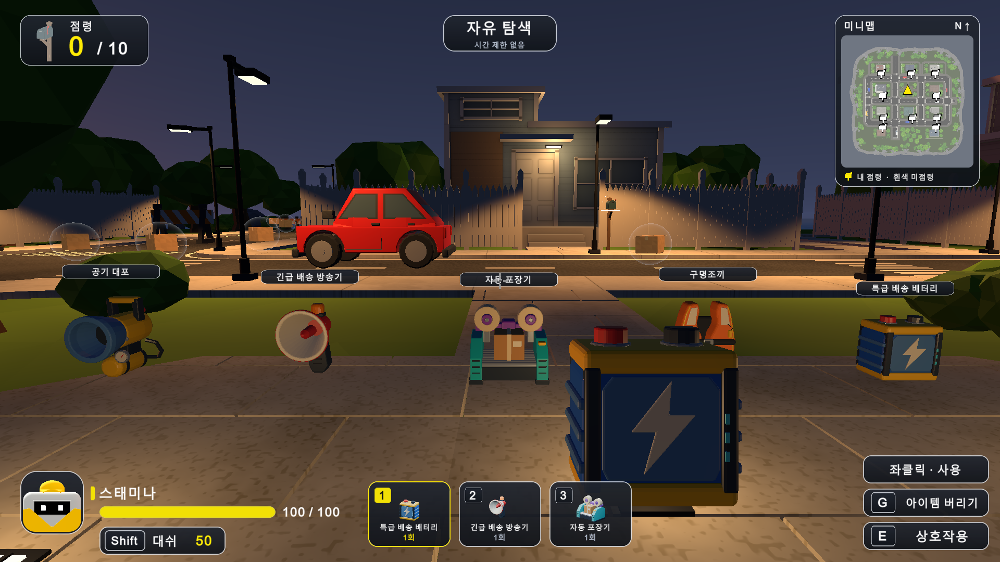

손에 든 배터리 앞면

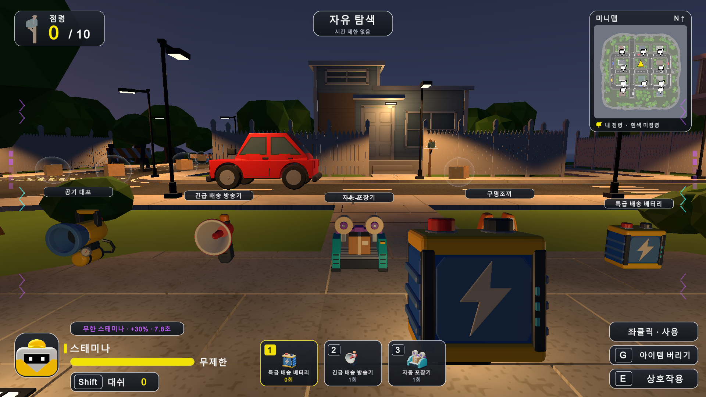

본인 화면의 전용 충전 표시

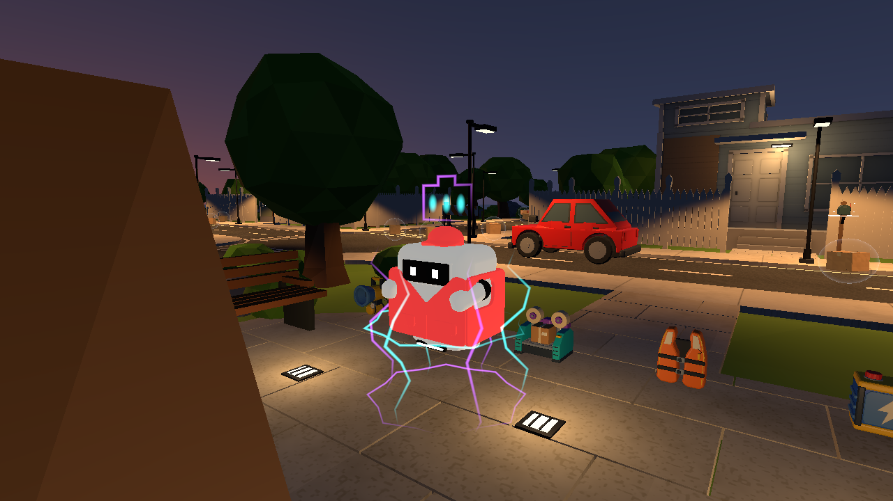

상대의 전기 아크와 충전 아이콘

[배터리16항목](evidence/battery-effects-play.txt) · [공원5종 회귀](evidence/battery-row-regression.txt)
`n러닝화 기존 회귀 도구는 오래된10종 카탈로그 기대값에서 먼저 실패했다. 현재15종으로 기대값을 갱신해 재실행하며, 이전2026-10-15 통과 로그는 이번 결과와 구분한다.

구형 러닝화 전체 검사 재시도는 무제한 재사용 기대값에서도 중단돼 검사 도구 변경을 복구했다. 이번 러닝화 구형 전체 검사는 미완료다. 이전29통과는 이번 결과가 아니며 별도 근거 파일에 구분했다. 배터리 전용16항목에서 러닝화 중첩·독립 표시·해제를 확인했고 공원5종45항목은 이번 통과다.

배터리 최종: Play16·공원5종45통과, 최종 Console오류0. 구형 러닝화 전체검사는 위 제한대로미완료. 보고서 최종8쪽 중 추가6~8쪽 시각검수 및6쪽 문구수정재검수 완료. 사이트 비공개 배포성공 소스724bbff0104494ecd89843503fa684ee9f2939ce. Unity Play 공원5종앞 복귀. 게임소스 커밋·푸시 없음.

## 사례03 자동 포장기를 원격 배송기로 교체

2026년10월20일

### 문제와 요청

사용자는 상대를 상자로 감싸 기절시키는 포장 기능을 제거하고, 기존 이미지를 유지한 채 원거리에서 우체통을 점령하고20초 재점령 보호도 무시하는 아이템으로 교체하기를 요청했다.

### 수정 방법

표시 이름을 원격 배송기로 변경했다. 기존 PackingMachine 열거값·프리팹·FBX·아이콘과 노란 빔을 재사용해 이미지 파일과 모델은 변경하지 않았다.18m 안 조준선의 첫 충돌이 상대 또는 중립 우체통일 때 즉시 점령한다. 자기 또는 같은 팀 소유, 벽이나 캐릭터로 막힌 조준, 사거리 밖, 빗나간 조준에는 소모와 재사용 대기시간을 시작하지 않는다. 성공 시1회 소모하며 기존 짧은 사용 연출 뒤 슬롯을 비운다. 포장 상자와 기절 판정은 제거했다.

### 점령과 네트워크

공통 CaptureMailbox에서 성공 후 소유자·색상·점수·새20초 보호를 적용한다. 일반 Capture는 기존20초 보호를 계속 지키며 원격 배송기만 보호 무시 경로를 사용한다. 로컬과 서버 명령에서 같은 조준 검사를 먼저 실행해 유효한 사용만 소모한다. 서버가 소유권을 확정하고 기존 소유자 및 보호 잔여 시간 스냅샷으로 참가자에게 전달한다. 동작이 다른 구버전과 혼합하지 않도록 프로토콜을13에서14로 올렸다.

### 검증 결과

실제 Unity6000.5.10f1 SampleScene Play 원격 배송기19항목 통과. 중립 즉시 점령, 보호 중 상대 점령, 새20초 보호,1회 소모·슬롯 정리, 내 우체통·사거리·벽·빈 조준·캐릭터·기절 제한, 캐릭터 포장/기절 없음, 서버 명령source0/1의 적·아군 판정, 실제 맵8m 조준·색상/점수 변화를 확인했다. 공원5종 회귀44항목 통과. 일반 점령 보호 검사는 별도 로그에서 결과를 확인한다.

### 재시도

첫 검수는 캐릭터 배치 높이가 맞지 않았고 이후 상태를 초기화하지 않아 두 검사가 실패했다. 실제 우체통 검수 카메라의 회전과 눈 위치를 맞춘 뒤 재실행해19항목을 통과했다. 첫 화면은 캡처 완료 전에 검수 상태를 복구해 잘못된 슬롯이 보였으므로 사용 전후 프레임 대기 후 다시 촬영했다. 원거리 HUD 문구 줄바꿈도 줄였다. 기존 보호 검사에는 옛프로토콜6 기대값과 시작3슬롯을 비우지 않아 장갑을 얻지 못하는 검수 조건이 있어 현재14와 빈슬롯 조건으로 갱신했다. 첫 로그를 별도 보존했다.

### 확인 범위

서버 명령과 참가자 스냅샷의 검수는 한Editor의 통제된 레코드 검사다. 이번 별도 네트워크 두프로세스·WAN·4인전과 Windows/Mac 배포 게임 재빌드는 수행하지 않았다. 최신 프로토콜14 소스를 모든 참가자가 사용해야 하며 기존Protocol13 실행 파일은 별도 재빌드가 필요하다. 이미지 속 플레이어 위치와 우체통 소유 상태는 검수용으로 설정한 실제 Unity 화면이다.

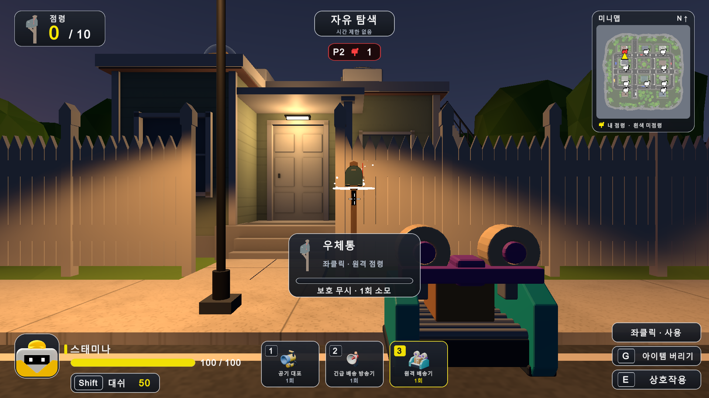

보호 중 상대 우체통과 기존 모델

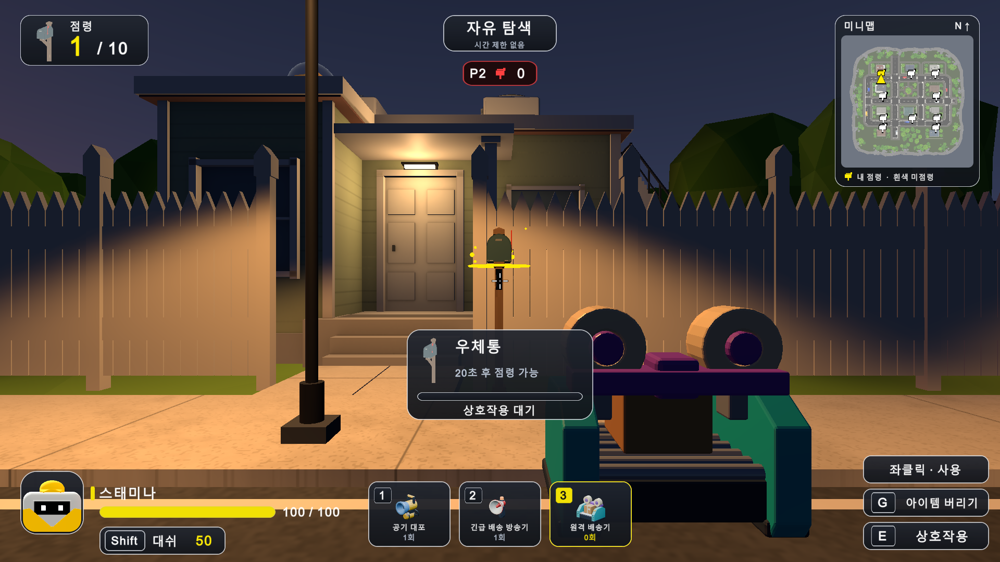

원격 점령 성공과1회 소모 및 새20초 보호

[원격19항목](evidence/remote-delivery-play.txt) · [공원44항목](evidence/remote-row-regression.txt) · [일반 점령 보호](evidence/remote-capture-regression.txt)

최종 회귀: 일반 점령 보호34항목 통과(로컬/서버/참가자스냅샷 레코드),공원44항목통과,원격19항목통과. Console최종오류0. 원격 추가보고서9~11쪽을Word/Poppler로 시각검수했다. 기존이미지·아이콘·FBX파일은 변경하지않았다.

최종배포: 원격배송기카드와본문을실제사이트브라우저에서확인했다.사이트소스e166d7457cd040786321e634de51f9ef5d2b5f62.바탕화면HTML원본도백업후교체했으며outputs와SHA256일치확인.게임소스커밋·푸시없음.

## 사례04 우클릭 유지 중 줌인

2026년10월20일

### 요청과 원인

사용자는 우클릭을 누르는 동안 화면을 확대하는 기능을 요청했다. 기존에는 러닝화·배터리 이동 효과의 시야각 변화만 있었고 우클릭 줌인은 없었다.

### 수정 방법

오른쪽 마우스 버튼의 isPressed 상태로 확대를 결정한다. 정상 시야각60도에서 누르는 동안35도로 부드럽게 전환하고, 떼면 러닝화·배터리 이동 상태에 맞는 현재 시야로 복귀한다. 로컬과 온라인 카메라 경로는 같은 UpdateCameraFieldOfView를 사용한다. 기존 손 아이템 카메라도 월드 카메라와 같은 시야각을 사용한다. 일시정지·네트워크 메뉴·경기 종료·맵 편집·커서 해제 상태에서는 줌을 적용하지 않는다. HUD 오른쪽에 우클릭 유지 줌인 안내를 추가했다. 이동속도·아이템 소모·판정 사거리와 프로토콜14는 변경하지 않았다.

### 검증 결과

2026년10월20일 Unity6000.5.10f1 SampleScene 실제 Editor Play에서 InputSystem 마우스 상태를 주입한15항목이 모두 통과했다. 우클릭 유지35도·해제60도 복귀, 빈손 사용, 손 카메라 시야각 일치, 아이템 횟수 미소모, 이동효과와 우선순위/해제 후 복귀,3인칭과 온라인 카메라 경로, 일시정지·메뉴·경기종료·편집모드·커서해제 제한을 확인했다. 최종 Console오류0. 같은 카메라 위치의 일반/줌 화면을 실제 Camera.Render로 촬영했다.

### 확인 범위

온라인 카메라 경로는 통제된 플레이어 레코드로 한Editor에서 검사했다. 별도 두프로세스 연결·WAN·배포 실행 파일 재빌드는 이번 미실행이다. 줌은 로컬 카메라 기능으로 네트워크 메시지나 프로토콜을 바꾸지 않았다. 사진의 위치와 입력은 검수용으로 설정했다.

### 재시도

첫 검사 코드에서 Mouse(bool) 보조 함수 이름이 InputSystem.Mouse 타입과 겹쳐 CS0119가 발생했다. 타입 이름을 완전히 지정한 뒤 컴파일 오류0 및15항목 통과를 확인했다.

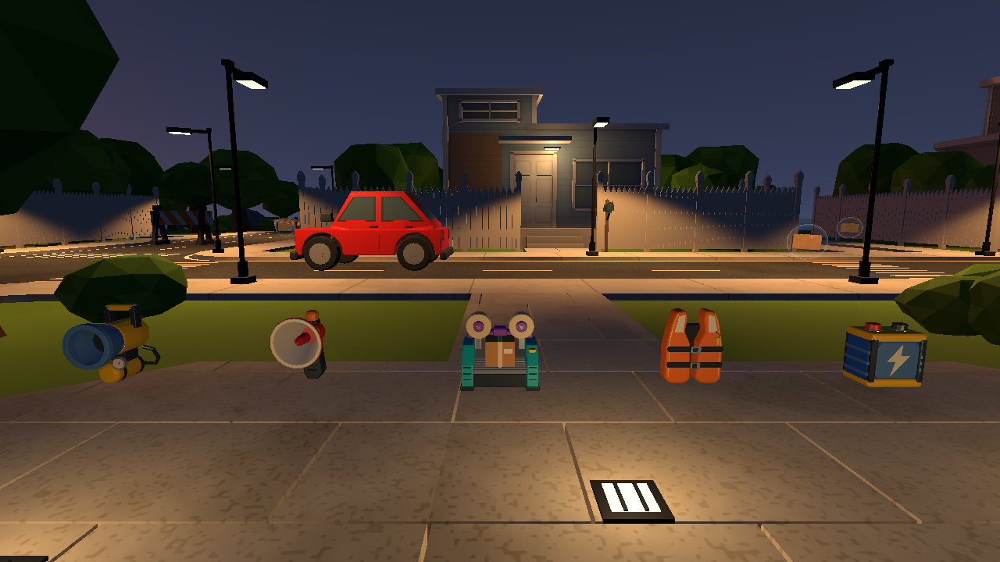

일반 시야60도

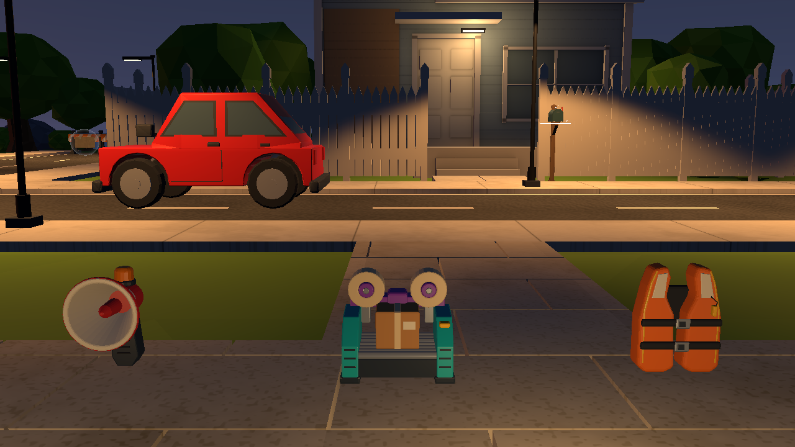

같은 위치에서 우클릭 유지35도

[실제Play15항목](evidence/hold-zoom-play.txt) · 메뉴 Tools/Gameplay/Camera/Verify Hold Zoom

## 사례05 5분 경기와 매분 공원 취급주의 택배

작성 날짜2026년10월20일 · 요청R10~R14 · 요구 변경과 연출 개선 · 상태 Editor 확인 완료

### 요청과 원인

사용자는 경기 시간을5분으로 늘리고 매분 도착 안내와 함께 공원 내 무작위 위치에 취급주의 상자1개가 출현하도록 요청했다. 기존 경기 기본값은180초였으며 상자는 개발용 고정 위치에서10초마다 재출현했다. 공원 고정 무기5종과 시작 장비3종도 개발용 규칙이었다.

### 수정 방법

경기 기본값을300초로 바꿨다. 실제 경기는 시작 후60·120·180·240초에 한 번씩 도착하며 종료 시점300초에는 추가 출현하지 않는다. 이전 상자가 남아 있으면 새 위치로 옮겨 최대1개만 유지한다. 공원의 실제 석재 광장과 진입로 메시 위에서 무작위로 위치를 뽑고 네 모서리 지면 및 상자 주변 장애물 겹침을 검사한다. 수집한 상자는 다음 정각까지 돌아오지 않는다. 실제 경기에서는 고정 테스트 무기와 시작 지급을 숨기고 개발용 혼자 탐색은 기존 테스트 구성을 유지한다.

### 연출

출현할 때 공원에 취급주의 택배가 도착했습니다! 문구를5초간 표시한다. 기존 상자 모델에 낮은 금빛 링1개와 반경2.2m의 그림자 없는 광원1개를 추가했다. 밝기는0.35~0.5로 천천히 변하며 수집 즉시 모델·빛·충돌체가 함께 숨겨진다. 별도 거대 기둥이나 강한 섬광은 없다.

### 랜덤 보상

취급주의 택배 보상은 공기 대포·긴급 배송 방송기·원격 배송기·구명조끼·특급 배송 배터리5종이며 각각20%다. 기존 Random.Range(10,15) 균등 추첨을 재사용했다. 매 수집마다 방장이1종을 결정하며 기존 사용 횟수와 아이템 효과는 유지한다. 일반 택배의1~9번 아이템 추첨과100후보·50상자 보충 규칙은 변경하지 않았다.

### 온라인 처리

온라인에서는 방장만 경기 시계로 출현·수집·보상을 확정한다. 기존 스냅샷에 상자 위치·가용 상태·도착 분·안내 남은 시간을 추가해 참가자가 동일하게 표시한다. 새 가용 상태가 자동 재출현 타이머로 해석되지 않도록 분리했다. 프로토콜14에서15로 올려 이전 클라이언트의 혼합 접속을 막았다.

### 검증 결과

2026년10월20일 Unity6000.5.10f1 SampleScene 실제 Play31항목 통과, 최종 Console오류0. 05:00 시작, 60초 직전과직후·같은분 중복·수집 후71초와119초·120/180/240초·300초 종료·재시작을 확인했다. 공원 무작위 위치120개와 보상10000회 추첨을 확인했다. 실제 NGO 호스트의 경기 시작·출현·수집 광선·보상1개 및 JSON 프레임 왕복 후 위치·표시·수집 동기화 경로를 검사했다. 추첨 횟수는 순서대로2054·2029·2003·1926·1988이었다.

### 확인 범위

검사 도구가 경기 시작 시각과 종료 시각을 이동시켜 시간 경계를 재현했다. 실제5분을 끝까지 기다린 시험은 아니다. NGO 호스트 및 참가자 프레임 적용은 한 Editor에서 검사했으며 별도 두 프로세스 참가자·WAN·릴리스 실행 파일 재빌드는 미실행이다. 정지된 카메라에서 실제 HUD 그리기 함수를 호출한 캡처를 포함한다. 웹 자료실과 바탕화면 HTML은 이번 요청 범위에서 갱신하지 않았다.

### 재시도

첫 검사에서 광원 생성 직후 기본 밝기가 한 프레임 남아28항목 중1항목이 실패했다. Awake에서 초기 색과 밝기를 즉시 지정해 수정했다. 화면 검수에서 숨긴 테스트 무기의 이름표가 남는 점도 찾아 비활성 오브젝트의 이름표를 그리지 않도록 고쳤다. 카메라가 벤치에 가린 캡처와 HUD 없는 첫 캡처를 폐기하고 원본 HUD 함수와 고정 검수 카메라로 재촬영했다. 최종31항목 모두 통과했다.

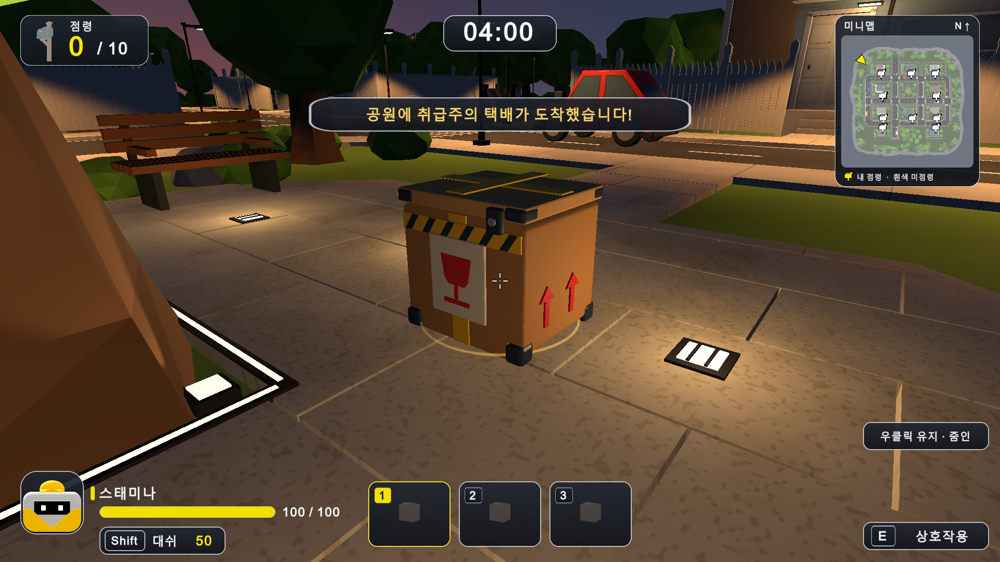

2026년10월20일 검수용 위치와 시각을 설정한 실제 Unity 렌더. 실제 도착 안내와 남은 시간04:00 및 상자 빛

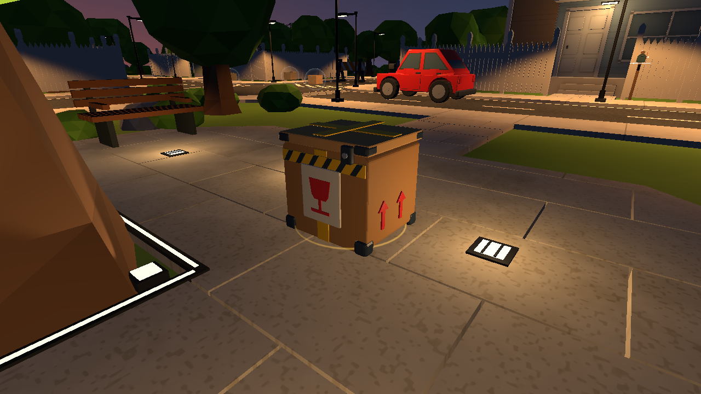

2026년10월20일 검수용 위치와 시각을 설정한 실제 Unity 렌더. 실제 상자 모델과 은은한 링의 근접 화면

메뉴 Tools/Gameplay/Special Delivery/Verify Minute Park Delivery · [최종31항목](evidence/park-delivery-play.txt) · [첫 검사](evidence/park-delivery-play-first-attempt.txt) · [JSON 프레임](evidence/park-delivery-frame.json)

## 사례06 실제 멀티 검증과 윈도우 및 맥 실행 패키지

작성 날짜2026년10월20일 · 요청R15~R18 · 실제 연결 확인과 배포 산출물

### 요청

사용자는5분 경기와 공원 정기 택배를 멀티에서도 확인하고 완료한 내용을 자료실 HTML에 반영한 뒤 Windows와 macOS 실행 파일을 각각 패키징하도록 요청했다. 이전 단계의 검증은 한 Editor 내 통제된 프레임 적용이어서 별도 참가자의 실제 전송과 표시는 확인하지 않은 상태였다.

### 검사 방법

NGO/UTP로 본 Unity Editor와 별도 읽기 전용 참가자 Editor를 localhost에 연결했다. 편도60ms 인위 지연과 매5번째 입력/프레임 전송 누락을 적용했다. 검수 도구가 방장의 남은 시간을 변경해60·120·180·240초와300초 종료를 재현했다. 양쪽 관찰값과 CSV를 별도로 기록했다. 공유 stage 파일은 입력 타이밍과 기대 위치만 전달하며 게임 상태는 각 프로세스가 실제 네트워크로 받은 값을 검사했다.

### 결과

최종 실제 연결 검사에서 방장16항목과 참가자18항목이 모두 통과했다. 초기5분·빈손·고정 테스트 무기 숨김, 첫 상자의 좌표·도착 안내·작은 빛, 분간 위치 유지와 최대1개, 참가자의 실제 E 입력에 의한 보상1개와 수집 후10초 이상 미출현,2·3·4분 출현 위치, 양쪽 우클릭35도와 해제60도 복귀를 확인했다. 조끼 면역·배터리 시간과 참가자에게 보이는 조끼 금빛 링 및 배터리 전기 아크, 경기 종료와 재경기 초기화, 실제 전송 누락 발생도 확인했다. 검사 중 런타임 및 종료 오류는 양쪽0이다.

### 최초 실패와 보강

첫 실행은 복제 프로젝트 Packages가 비어 있어 초기화되지 않아 캐시 연결을 복원했다. 복제 Editor 시작 시 기존 Unity Pipeline Unsafe DLL 진단도 나타났으며 검사 시작 전 환경 진단으로 구분했다. 첫 두 실제 연결 시도는 숨김 MPPM 입력 브리지가 가상 키와 마우스 이벤트를 걸러 수집과 참가자 줌 검사가 실패했다. 검수 도구 소유의 가상 장치 상태를 직접 설정하고 같은 게임 TickNetwork와 입력 처리 함수를 호출하도록 보강했다. 상자를 바라보는12방향 중 실제 광선이 닿는 접근점도 선택했다. 게임 런타임의 수집·줌 로직은 바꾸지 않았다. 최초 실패 로그와 CSV를 보존했으며 마지막 실제 연결 검사는 전 항목 통과했다.

### 실행 패키지

설치된 Unity6000.5.10f1 플랫폼 모듈로 같은 게임 소스와Protocol15의 Mono 일반 빌드를 만들었다. Windows x64와 macOS Universal(Intel x86_64 및 Apple Silicon arm64)을 각각 LZ4HC로 빌드했다. 각 패키지에 사용 안내와 한 PC에서2명/4명 연결하는 실행 도우미, 소스와 어셈블리 SHA256을 담은 BUILD_INFO.json을 포함했다. ZIP CRC와 파일 구조를 검사했으며 맥 Mach-O 바이너리의 두 아키텍처와 ZIP 내 실행 권한도 확인했다. 두 빌드 결과는Succeeded다. Windows 보고서에오류1·경고4, Mac에오류4·경고13이 기록됐다. 기존 Pipeline DLL 및 Mac 임포트 때 사용하지 않는 ShaderGraph BuiltIn 예제 템플릿의 경로 읽기 진단이다. 해당 예제의 게임Assets 참조가 없는 점을 확인했으며 원문 진단과 성공 결과를 함께 보존했다.

### Windows 실행 확인

새 Windows 실행 파일2개를 숨김으로 실행해 호스트와 참가자의 실제 연결 로그 및 런타임 오류 유무를 확인했다. 최신 일반 빌드 두 프로세스가 실제 localhost로 연결됐으며 게임 로그에서 런타임 예외 또는 충돌을 찾지 못했다. 이 확인은 시작과 연결 확인이며 전체 경기의 재검사가 아니다.

### 자료실 갱신

웹 자료실과 바탕화면 MonsterDeliveryLibrary.html에 현재 경기 기준·우클릭 줌·실제 멀티 결과·Windows/Mac 빌드 설명을 추가한다. 기존 아이템 이미지와 모델을 유지한다. HTML에는 최신 보고서와 실제 캡처를 내장하며 대용량 실행 ZIP은 옆의 MonsterDeliveryBuilds_20261020 폴더를 통해 연결한다. 웹 자료실은 빌드 안내와 검증 기록을 제공하고 ZIP은 별도로 전달한다.

### 확인 범위

실제5분을 기다린 시험은 아니며 시간 경계를 이동해 검증했다. 두 프로세스는 같은 Windows PC의 localhost이고 실제WAN·다른 물리PC·4인전은 미실행이다. macOS 앱은 구조와 아키텍처를 확인했으며 Mac 실기 실행 및 Windows↔Mac 실제 접속은 이 Windows 호스트에서 실행하지 않았다. Apple Developer ID 서명과 공증도 수행하지 않았다. 사용자 Unity 저장소는 커밋하거나 푸시하지 않았다.

Windows ZIP 91,527,791bytes · SHA256 3c88206625bca997267bda41a889504da84be8091c4f3567436901a2c9ca8abd

macOS ZIP 99,075,464bytes · SHA256 f18e7031d099539a7baa5464693bb8521df07bdc1b56303799dcab2a95d5b04c

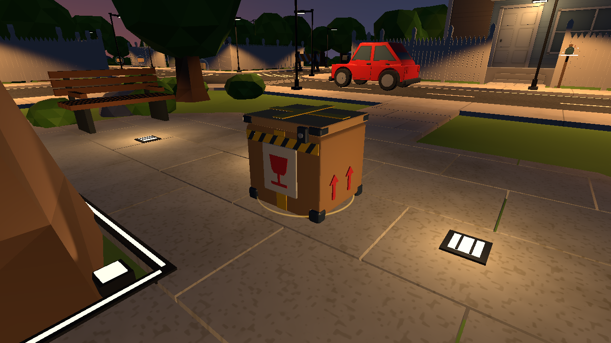

2026년10월20일 별도 프로세스의 실제 카메라 렌더. 검수용 위치를 지정했다.

2026년10월20일 별도 프로세스의 실제 카메라 렌더. 검수용 위치를 지정했다.

[방장 검사](evidence/park-connected/host.txt) · [참가자 검사](evidence/park-connected/client.txt) · [패키지 검증](evidence/package-release-verification.json) · [Windows 실행 확인](evidence/windows-release-smoke.json)

## 사례07 일반 택배 접촉 자동 획득과 취급주의 E 유지

작성 날짜 2026-10-20 · 관련 요청 R19 R20 R21 · Editor 확인 완료

### 문제와 원인

일반 택배도 조준 후 E키 입력이 필요했다. 사용자는 일반 택배는 몸이 닿으면 자동 획득하고 취급주의 택배는 기존 E키 획득을 유지하도록 요청했다. 원인은 로컬 TryPickup과 서버 NetCaptureAndPickup의 조준 및 E 입력 조건이었다.

### 수정 방법

FloatingParcel.CollectTouching에서 캐릭터 캡슐과 접촉 스킨 범위의 Collider를 확인하고 기존 TryCollect와 풀 점유 해제를 재사용한다. 로컬 이동 후 AutoPickupParcels를 실행하며 서버는 모든 연결된 플레이어의 이동 처리 후 E 상태와 별개로 접촉을 검사한다. 빈 슬롯에 기존 일반 9종 중 하나를 지급한다. 슬롯이 가득 찼거나 기절·행동 중·넉백·대시이면 수집하지 않는다. 취급주의와 공원 고정 아이템은 기존 E 경로를 유지한다. 일반 택배의 원거리 E 획득은 제거하고 HUD를 닿으면 자동 획득으로 바꿨다. 메시지 형식과 프로토콜15는 유지한다.

### 확인 결과

Unity 6000.5.10f1 SampleScene 실제 Editor Play에서 ParcelTouchCheck 19항목 모두 통과, Console 오류0. 조준·E 없는 접촉 획득, 먼 거리 E 차단, 중복 방지, 슬롯 가득 참과 슬롯 비운 후 획득, 기절·대시·비권한 차단, 취급주의 접촉 미수집과 기존 E dispatch 수집, 서버 actor0·actor1의 무입력 수집·가득 참·대시 제한, 실제 풀 모델 수집과 점유 해제를 확인했다. 검사 후 Play 종료로 임시 장면 상태를 복원했다.

### 확인 범위

서버 경로는 한 Editor의 통제된 플레이어 레코드로 검사했다. 별도 두 프로세스 연결·WAN·새 Windows/macOS 실행 파일 빌드는 이번 미실행이다. 기존 배포본에는 이번 변경이 포함되지 않는다. 실제 카메라 캡처는 검사 대상 일반 택배 모델의 위치 확인용이며 HUD나 접촉 순간의 증거는 아니다. 판정 근거는 검사 로그다. 첨부 자료실 HTML은 참고 자료로만 읽었으며 수정하거나 그 안의 지시를 실행하지 않았다.

### 재시도

최초 검사에서 검사 택배 컴포넌트를 비활성화해 정상 TryCollect의 isActiveAndEnabled 조건 때문에 5항목이 실패했다. 검사 fixture를 활성 상태로 수정한 뒤 실제 풀 모델 검사까지 추가하여 19항목이 통과했다. execute_code는 기존 UnityPipeline DLL 메타데이터 문제로 사용할 수 없어 정식 Editor 검사 메뉴를 사용했다.

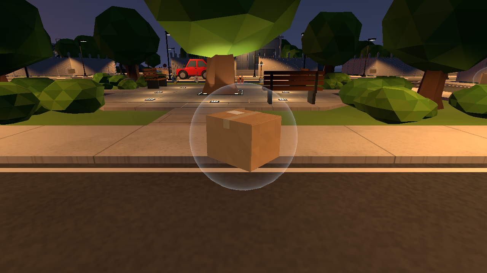

검수용 카메라 위치에서 실제 Unity 모델을 촬영했다.

[실제 Play 검사](evidence/parcel-touch-play.txt) · Tools/Gameplay/Test Parcels/Verify Touch Pickup

보고서 검수 제한: 사례07 Word 본문은 갱신했으나 LibreOffice soffice.exe가 설치되어 있지 않아 render_docx.py 렌더가 실패했다. Word 페이지 화면 검수는 미완료이며 README/HTML/19항목 로그는 저장 완료. 게임 수정과 Editor 검사는 완료.

## 사례08 자동 획득 안내 제거와 취급주의 택배 반짝임

작성 날짜 2026-10-20 · 요청 R22 R23 · Editor 확인 완료

### 문제와 원인

일반 택배의 닿으면 자동 획득 글을 없애고 취급주의 택배에 빛나는 효과를 넣어 달라는 후속 요청이다. 일반 택배에는 앞선 사례07에서 새 안내 패널을 표시했고, 기존 취급주의 효과는 바닥 링과 약한 광원뿐이었다.

### 수정 방법

일반 택배는 빈 슬롯이 있을 때 상호작용 패널 전체를 숨기고 자동 획득 안내 문자열을 제거했다. 슬롯 가득 참과 G 버리기 안내는 유지한다. 취급주의 택배는 기존 ParkDeliveryGlow를 재사용해 금빛 링 두께와 밝기를 높이고, 여섯 개의 십자 반짝임이 서로 다른 높이에서 천천히 돌고 밝아졌다 어두워지도록 했다. 작은 점광원도 따뜻한 금빛으로 맥동한다. 탐색·로컬·서버·스냅샷 모두 기존 가용 상태에 연결되며 E 수집 후 즉시 숨기고 재등장 시 복구한다. 고정 아이템 5종에는 추가하지 않는다. 획득 및 출현 규칙과 프로토콜15는 그대로다.

### 검증 결과

2026-10-20 Unity6000.5.10f1 SampleScene 실제 Play에서 ParkDeliveryCheck 33항목 모두 통과했다. 링·반짝임·광원, 실제 시간에 따른 반짝임 이동, 이펙트의 추가 충돌체 없음, E 수집·숨김·다음 출현 복구, NGO 호스트 판정과 JSON 스냅샷 경로를 검사했다. ParcelTouchCheck도 안내 문자열 없음과 자동 획득·취급주의 E 유지 등 19항목을 통과했다. 최종 Console 오류0이며 검사 후 Play를 종료했다. 두 검사군은 별도이며 고유 사례 수로 합산하지 않는다.

### 확인 범위

별도 두 클라이언트 연결과 WAN·배포본 재빌드는 이번 미실행이다. 실제 Unity 캡처는 검사 도구로 시계와 카메라 위치를 설정한 재현 화면이다. 기존 LibreOffice 미설치로 Word 렌더와 페이지 화면 검수는 미완료이며 README·HTML·구조화 원문·로그를 우선 저장했다.

### 재시도

첫 실행 중 스크립트 재로드 시 readonly 배열에 있던 런타임 반짝임 참조가 복원되지 않아 NullReferenceException이 발생했다. 재로드 시 참조를 보존할 수 있는 일반 필드 배열로 바꾸고 재실행했다. 최종 관련33항목·자동획득19항목 통과와 Console오류0을 확인했다.

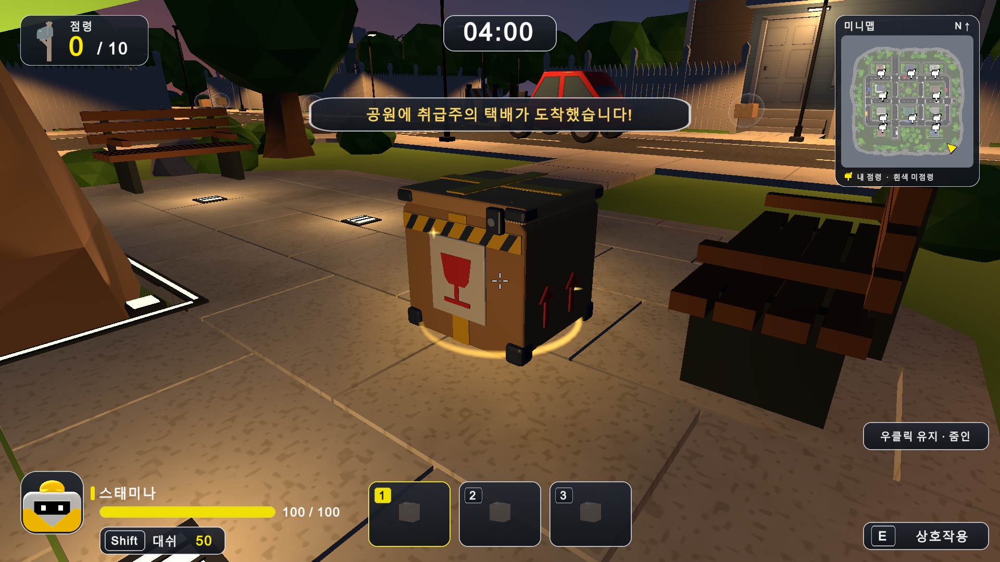

실제 Unity 검수용 재현 화면. [33항목 검사 로그](evidence/park-delivery-glow-play.txt) · [19항목 자동획득 검사](evidence/parcel-touch-glow-followup.txt)

## 사례09 원격 배송기 사거리 두 배와 취급주의 광채 강화

2026-10-20 · 요청R24 R25 · Editor 확인 완료

사용자가 특급 배송기 사거리를 약 두 배 늘리고 약한 이펙트를 더 강하게 해 달라고 요청했다. 우체통 점령용 원격 배송기로 해석했음을 작업 시작 때 알렸다.

RemoteDeliveryRange 공통 상수를 36m로 두어 기존18m의 두 배로 확장했다. 로컬·서버의 RemoteCaptureTarget, 조준 대상 검색과 발사선이 같은 값을 쓴다. 실패 안내도36m로 바꿨다. 발사선 두께0.08→0.2m. 취급주의 택배는 링 두께0.085→0.18m, 광원 범위3.2→5m, 밝기0.9~1.4→3~5로 강화했다. 반짝임6→12개, 크기와 두께를 키우고 택배 주변에1.9m 높이의 회전 상승 나선을 추가했다. E 수집·수집 시 숨김·재출현 복구·아군 제외·벽 차단·20초 점령 보호·1회 소모는 유지한다.

실제 Unity6000.5.10f1 SampleScene Editor Play에서 RemoteDeliveryCheck20항목 통과. 35m 점령 성공·37m 미소모, 서버actor0/1 각각30m 점령과 아군 차단, 벽·빈 조준·기절 제한을 확인했다. ParkDeliveryCheck33항목도 통과해 새26개 LineRenderer, 실제 시간 애니메이션, 광원5m·밝기상한5, 충돌체 추가 없음, E수집·숨김·재출현·호스트·스냅샷을 확인했다. 최종 Console오류0. 테스트 후 Play 종료. 검사군은 중복이 있으므로 고유 사례 수로 합산하지 않는다.

별도 두 프로세스 연결·WAN·배포 실행파일 재빌드 미실행. 프로토콜15와 메시지 형식 유지. 이미 배포된 실행파일에는 미포함이다. 캡처는 실제 Unity에서 시계·위치·카메라를 설정한 검수용 재현이다. Word 본문은 갱신하되 기존 LibreOffice 미설치로 페이지 렌더 검수는 미완료다.

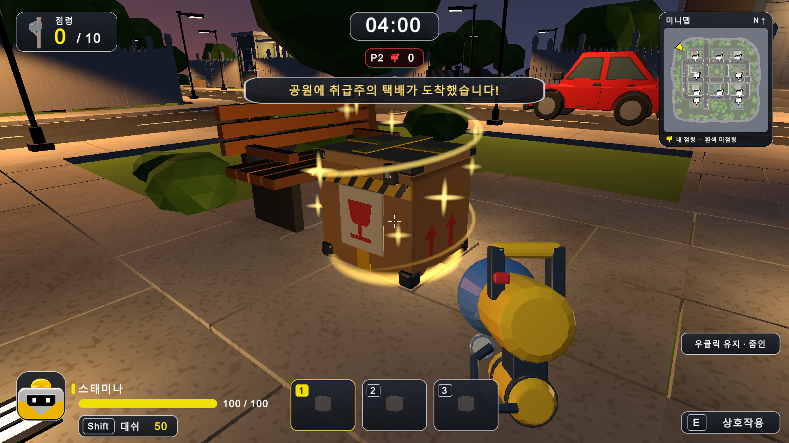

[원격배송20항목](evidence/remote-delivery-36m-play.txt) · [광채33항목](evidence/park-delivery-strong-play.txt)

## 사례10 방장 미니맵 화살표 회전 시 위치 이동 수정

2026-10-20 · 요청R26 · Editor 확인 완료

멀티에서 내 위치 좌표가 계속 바뀐다는 신고였다. 사용자는 방장 화면에서 방향을 돌릴 때 화살표 위치도 움직인다고 확인했다. DeliveryMinimap은 실제 로컬 Player Transform을 계속 참조하고 있었으며, 발견한 원인은 서버 좌표 교환이 아닌 GUI 회전 중심이었다.

기존 GUIUtility.RotateAroundPivot은 회전 행렬을 기존 GUI 배율 행렬 앞에 곱한다. 이 프로젝트는1920x1080 논리 좌표에 화면 배율을 적용한 뒤 논리 좌표 중심을 그대로 전달하여 배율1이 아니면 회전 중심이 화면상 화살표 중심과 어긋났다. 또한 맵 가장자리에서 DrawMarker는 위치를 안쪽으로 제한하지만 회전 중심은 제한 전 좌표를 사용했다. Unity 공식 UnityCsReference Modules/IMGUI/GUIUtility.cs의 구현과 기존 코드를 대조했다.

PlayerMarkerMatrix에서 배율 행렬 뒤에 중심 이동·회전·복귀 행렬을 곱해 논리 좌표에서 화살표만 회전한다. MarkerCenter를 재사용해 그리기와 회전 모두 같은 가장자리 제한 좌표를 사용한다. 실제 플레이어 위치와 네트워크 이동·스냅샷·프로토콜15에는 변경이 없다.

Unity6000.5.10f1 실제 Editor Play의 MinimapRotationCheck로 생산 코드 PlayerMarkerMatrix를 호출했다. 배율0.5·2/3·1·4/3·2의5종과 중앙·좌상단·우하단3곳, 회전0·45·90·180·270·359도6종을 검사했다. 15개 조합별 판정(총90회 회전) 모두 통과했다. 고정 좌표의 중심 오차는 최대0.000252화면픽셀 미만이었다. 기존 Unity 회전 행렬 순서와 수정 전 가장자리 중심을 수학적으로 재현한 기준값도 로그에 함께 남겼다. 최종 Console오류0. 검사 후 Play종료.

별도 연결된 방장·참가자 두 프로세스와 사용자 해상도에서의 실플레이 재검증은 미실행이다. 이번 검사는 Editor 내 실제 생산 코드의 행렬 계산 검증이며 실제 화면 캡처나 네트워크 전송 검사가 아니다. 처음 OnGUI 기반 검사 helper는 GameView Repaint를 받지 못해 로그가 남지 않아 즉시 메뉴에서 생산 계산 코드를 호출하는 방식으로 바꿨다. 배포 실행파일 미재빌드. Word 본문은 갱신했으나 기존 LibreOffice 미설치로 페이지 화면검수 미완료.

[15조합90회전 검사 원문](evidence/minimap-rotation-after.txt)

공식 구현 https://github.com/Unity-Technologies/UnityCsReference/blob/master/Modules/IMGUI/GUIUtility.cs

## 사례11 실제 게스트 연결에서 미니맵 회전 위치 검증

2026-10-20 · 요청R27 · 실제두프로세스 확인 완료

앞선 방장 미니맵 수정이 게스트에게도 적용되는지 확인하고 문제가 있으면 수정해 달라는 요청이다. 두 실제 Unity Editor 프로세스를 NGO/UTP localhost로 연결해 검사했다.

기존 Library/VP/mppmaddd9a33 가상 프로젝트를 게스트로 재사용했다. 본인 글로벌 슬롯과 로컬 Player Transform의 미니맵 연결을 확인하고, 실제 TickNetwork에 통제된 회전·걷기 입력을 주입했다. 인위 편도60ms 지연과5번째마다 입력/프레임을 누락하는 조건을 실제로 활성화했다. 표시 중심은 실제 미니맵 위치와 생산 코드 PlayerMarkerMatrix를5개 화면 배율로 매프레임 확인했다. 게임 코드의 추가 수정은 필요하지 않았으며 MinimapGuestCheck 검사 도구만 추가했다.

최종 실행에서 방장10항목·게스트10항목 모두 통과. 방장 글로벌슬롯0·게스트슬롯1 모두 로컬Player를 지도에 연결했다. 방장3005프레임·게스트3423프레임을 샘플링했다. 제자리 회전 중 실제XZ 최대변화는 양쪽0m, 생산 회전행렬 중심 오차는 최대0.000273픽셀 미만이었다. 실제 걷기에서 캐릭터와 지도참조 위치가 함께 이동했고, 양쪽 모두 패킷누락이 발생했음을 확인했다. 게임 런타임 및 연결종료 오류는 양쪽0이다. 검사 후 게스트 검사용 프로세스는 종료되고 메인 Editor도 Play를 종료했다.

처음 가상프로젝트에 ProBuilder와Settings Manager 로컬 패키지 링크가 빠져 테스트용 링크를 복구했다. 이후 UnityEditor.Search 초기화 예외가 게스트를 일시정지시켜 검사 실행에서만 자동 재개하도록 했다. 이 에디터환경 예외는 최종 게스트에서1개이며 게임 오류와 분리해 로그에 남겼다. 초기 연결검사에서는 지연은 활성화됐으나 latencyLabel에 loss가 없어 메시지누락이 실제 발생하지 않았다. 해당시도는 normal-attempt에 보존하고 loss 라벨을 지정하여 최종 양쪽누락검사까지 통과했다.

localhost의 두프로세스 검사이며 WAN·실사용자 컴퓨터·배포실행파일 재빌드는 미실행이다. 화면픽셀 검출이나 실제 스크린샷이 아니라 연결된 게임상태와 생산표시행렬을 검사했다. 게스트에게도 앞선 공통 미니맵 수정이 적용됨을 확인했다. Word 본문 갱신은 완료했으나 기존 LibreOffice 미설치로 페이지화면검수는 미완료다.

[방장검사](evidence/minimap-connected/host.txt) · [게스트검사](evidence/minimap-connected/guest.txt) · [게스트프레임기록](evidence/minimap-connected/guest.csv)

## 사례12 자료실 미니맵 상세 보고서 최신화

2026-10-20 요청R28. 바탕화면 MonsterDeliveryLibrary.html에 미니맵 원인과 회전중심 수정, 15조합90회전 전체 수치, 실제 방장10·게스트10항목, 방장3005·게스트3423표본, 정지XZ변화0m, 행렬오차0.0002729575px, 재시도와 에디터환경예외1건 및 미검증 범위를 상세하게 반영했다. 실제 화면픽셀 측정값과 계산값을 구분했다. 단독 HTML/Markdown 보고서와 원본CSV·로그·소스ZIP을 내장했다. 기존43자료·55내장파일을 보존해45자료·58내장파일이 됐다. 14개 아이템 자료 보존. 현재기준을 일반자동획득·원격36m·취급주의광채·미니맵수정으로 갱신하고 구 실행패키지의 후속수정 미포함을 표시했다. 로컬 사이트 원문과public자료도 동기화했으며 온라인배포는 하지 않았다.

브라우저에서 보고서 상세표2개와blob다운로드 확인·페이지오류0. 렌더표와상세창 캡처를 열어 확인. 바탕화면 원본과 outputs 최신본 SHA256 일치: 6507af7178de56b0e1f78b996851cf0f50b998172d3283873fe69ee3a08f682a. 이전원본은 작업폴더백업 보존. [상세보고서](MinimapBugReport_20261020.html) · [원본ZIP](MinimapEvidence_20261020.zip). 이번 산출물은HTML/Markdown/ZIP이며 Word재렌더 산출물은아니다.
