# 몬스터 딜리버리 서비스 아이템 트러블슈팅 기록

작성 기준 2026-10-15

이 보고서는 현재 대화에서 사용자가 요청한 아이템 관련 20개 항목을 프로젝트 코드, 수정 기록, 실제 Unity 캡처와 대조한 문서다. 13개 상세 절에서 어떤 문제가 있었고 어떤 방법으로 바꾸었는지, 그 결과를 무엇으로 확인했는지 설명한다.

화면 자료는 실제 Unity Game View다. 최종 모습은 2026년 10월 15일 다시 캡처했고, 초기 모습과 장갑 자료는 보존된 당시 화면을 날짜와 함께 표시했다. 수정 전 캡처가 없는 항목은 이미지를 재구성하지 않고 확인 가능한 이전 수치와 원인으로 설명했다.

## 사용자 요청 대조

| ID | 항목 | 요청 요약 | 상세 절 |
|---|---|---|---|
| R01 | 러닝화 | 유니티 연결 및 아이템 목록 확인 후 신발 모델 없이 본인과 상대에게 부스터 효과 표시 | 01 |
| R02 | 러닝화 | 상대 효과를 떠 있는 몸 높이로 올리고 하늘색 전 화면 박동 효과로 변경 | 01 02 |
| R03 | 러닝화 | 이동 속도 증가를 50퍼센트로 올리고 상대 효과 범위 확대 | 02 |
| R04 | 러닝화 | 부스터 연출을 더 자연스럽고 눈에 띄게 발전 | 02 |
| R05 | 목록 조회 | 현재 아이템 목록 다시 확인 | 부록 |
| R06 | 에어캡 | 손 모델 없이 본인과 상대에게 보호되는 효과 표시 | 03 |
| R07 | 에어캡 | 정지한 땡땡이를 폭폭 터지는 기포로 변경 | 03 |
| R08 | 에어캡 | 기포 안의 별 모양 제거 | 03 |
| R09 | 만년필 | 잉크를 돌아오지 않는 만년필 투척으로 바꾸고 적중 시 시야 차단 | 04 |
| R10 | 만년필 | 잉크에 가려지는 화면 범위를 확대 | 05 |
| R11 | 만년필 | 상대를 맞혔다는 사실이 보이는 적중 효과 추가 | 05 |
| R12 | 공통 방어 | 에어캡이 공격을 방어하지 않는 문제 확인 | 06 |
| R13 | 공통 방어 | 새 아이템도 바로 적용되는 공통 피격 파이프라인 구축 | 06 |
| R14 | 표면 잉크 | 플레이어 외 벽과 바닥에 검은 잉크를 남기고 1초 뒤 서서히 제거 | 07 |
| R15 | 뚫어뻥 | 흡착컵 끝과 크기에 걸리면 당겨지도록 좁은 판정 수정 | 08 |
| R16 | 슬라임 | 박스 테이프를 슬라임 투척으로 바꾸고 감속 효과 명확히 표시 | 09 |
| R17 | 슬라임 | 가로등 적중 및 높은 투척 도중 사라지는 현상 수정 | 10 |
| R18 | 뿅망치 | 확성기를 근접 뿅망치로 바꾸고 가까운 적 기절 | 11 |
| R19 | 뿅망치 | 양쪽 타격면을 본인과 상대 방향으로 돌리고 사거리 확대 | 12 |
| R20 | 망치와 HUD | 손잡이를 길게 하고 높이를 올리며 점령 패널과 미니맵 축소 | 13 |

## 01 러닝화 효과를 떠 있는 몸 높이에 맞추기

요청 R01, R02 · 연출 구현과 위치 수정

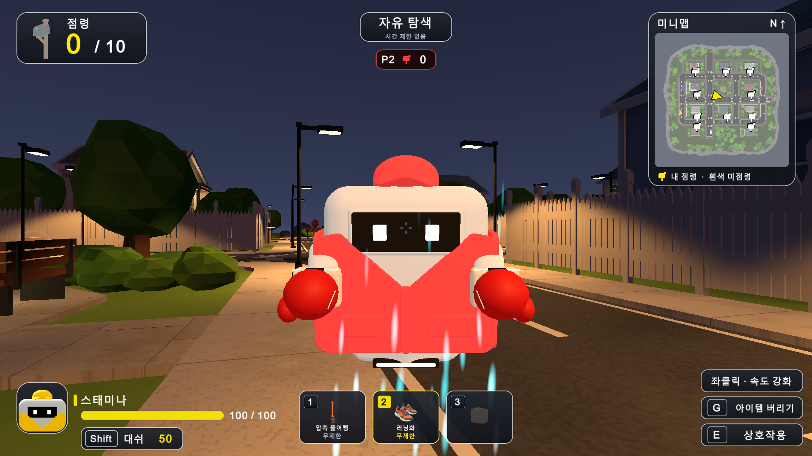

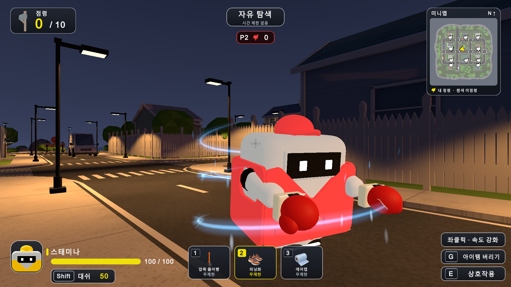

### 문제

러닝화는 이동 강화 아이템이어서 손에 신발을 드는 표현이 필요하지 않았다. 상대 효과는 발아래 빈 공간에 보여 떠 있는 로봇의 몸과 분리되어 보였다.

### 원인과 배경

입자 발생 기준이 캐릭터 컨트롤러 원점의 아래쪽에 있었고, 이 프로젝트의 로봇은 지면에서 떠 있다. 지면 기준 장식을 몸통 효과로 그대로 사용하면 시각적 중심이 어긋난다.

### 사용한 방법

HasHeldModel에서 러닝화 모델을 제외했다. 상대 바람 시작점을 로컬 Y -0.55m에서 +0.25m로 0.8m 올리고, 수명 0.65~0.85초와 상승 속도 1.1~1.4m/s를 조정해 하단 몸통에서 머리 주변으로 흐르게 했다.

### 해결 결과

손에 신발을 표시하지 않아도 발동을 알 수 있고, 상대의 효과가 몸통과 함께 이동한다. 효과가 끝나면 입자와 잔상을 정리한다.

### 확인 근거

Running Shoes 검사 29개를 2026년 10월 15일 다시 통과했다. 몸통 시작 높이, 손 모델 미표시, 활성화와 만료를 확인한다.

구현 위치 [Assets/Gameplay/HeldItemPresentation.cs](../../Assets/Gameplay/HeldItemPresentation.cs) · [Assets/Gameplay/RunningShoesAura.cs](../../Assets/Gameplay/RunningShoesAura.cs) · [Assets/Gameplay/RunningShoesFX.cs](../../Assets/Gameplay/RunningShoesFX.cs)

## 02 러닝화의 화면 박동과 속도 체감 개선

요청 R02, R03, R04 · 수치 변경과 연출 개선

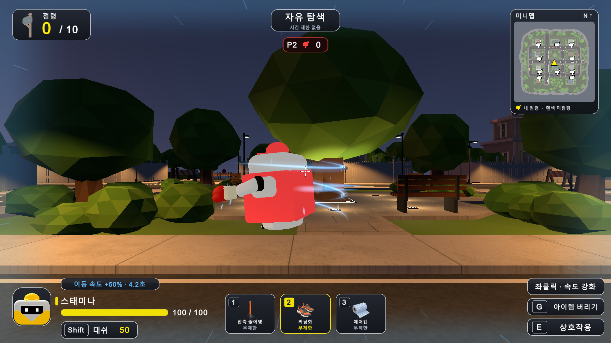

### 문제

본인 효과가 화면 양옆에만 보여 화면 전체를 감싸는 부스터 느낌이 부족했다. 상대 효과는 작아서 사용 여부가 잘 보이지 않았고, 입자만 크게 늘린 표현도 만족스럽지 않았다.

### 원인과 배경

표현 범위와 입자 크기만으로 속도감을 전달하려 해 화면의 방향성과 상대의 움직임을 충분히 드러내지 못했다.

### 사용한 방법

이동 배율을 1.4에서 1.5로 바꾸고 화면 안내도 +50%로 맞췄다. 하늘색 RGB 0.42 0.75 1의 네 가장자리 그라데이션에 강한 박동과 약한 박동, 쉼을 반복했다. 상대는 단순 큰 입자에서 회전 바람 3줄과 이동 시 0.24초 잔상, 작은 상승 입자로 개선했다.

### 해결 결과

5초간 이동 속도 +50%가 적용되고, 상대가 움직일 때 바람 띠와 잔상이 몸통을 둘러싼다. 화면 중앙은 투명하게 유지해 부스터 효과와 조준 시야를 함께 확보했다. 재사용은 지속 시간 갱신이며 배율이 중첩되지 않는다.

### 확인 근거

29개 검사가 네 가장자리와 투명 중앙, 강약 박동, 실제 회전, 이동 잔상, 종료 정리까지 확인했다. 슬로우와 함께 적용되면 0.6 × 1.5 = 0.9배다.

구현 위치 [Assets/Gameplay/DeliveryItemState.cs](../../Assets/Gameplay/DeliveryItemState.cs) · [Assets/Gameplay/RunningShoesFX.cs](../../Assets/Gameplay/RunningShoesFX.cs) · [Assets/Gameplay/RunningShoesAura.cs](../../Assets/Gameplay/RunningShoesAura.cs)

## 03 에어캡 기포가 터지는 보호막 만들기

요청 R06, R07, R08 · 연출 구현과 시각 요소 제거

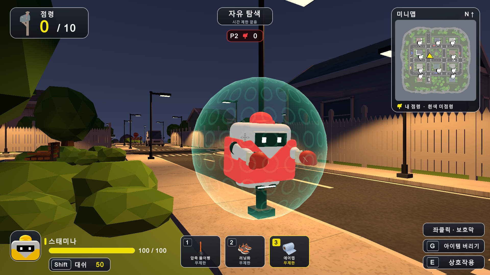

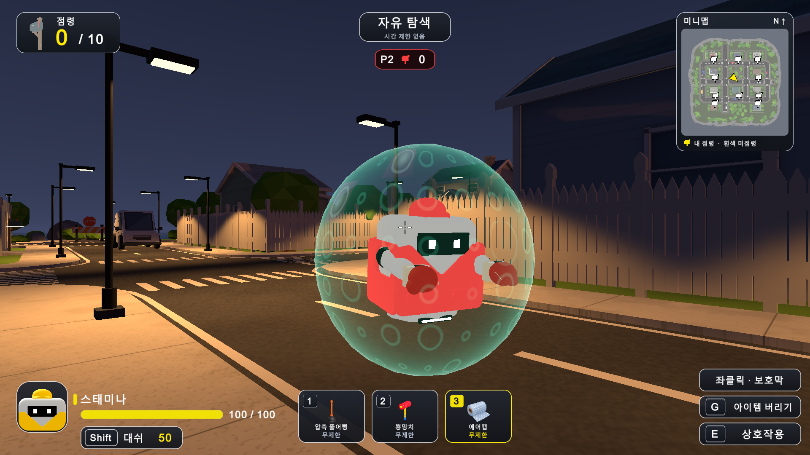

### 문제

에어캡은 손에 들고 있는 모델보다 보호 중이라는 표현이 필요했다. 보호막 표면의 점들이 정지해 보였고, 터지는 기포 안에는 요청하지 않은 별 모양이 나타났다.

### 원인과 배경

기포의 시간 변화가 부족했고, 셰이더의 각도 기반 6방향 spokes 계산이 별 모양을 만들었다. 장식 기포의 터짐과 실제 방어 성공에 따른 전체 파괴도 구별할 필요가 있었다.

### 사용한 방법

본인은 민트색 화면 가장자리와 기포, 상대는 떠 있는 몸을 감싸는 투명 보호막으로 표시했다. 셀별 난수와 _BubbleTime으로 부풀기, 확산, 사라짐, 재생성의 주기를 다르게 만들었다. 6방향 spokes를 제거하고 둥근 기포와 중심 빛을 유지했다.

### 해결 결과

보호막 표면이 각자 다른 타이밍으로 폭폭 터진다. 이 장식은 방어 횟수를 쓰지 않는다. 실제 유효 공격을 막으면 보호막이 약 0.45초 동안 퍼지며 터지고, 8초 자연 만료는 조용히 사라진다.

### 확인 근거

Bubble Wrap 검사 32개를 2026년 10월 15일 다시 통과했다. 서로 다른 시간의 렌더 픽셀 비교, 한 번 방어, 다음 타격 적용, 자연 만료를 포함한다.

구현 위치 [Assets/Gameplay/BubbleWrapFX.cs](../../Assets/Gameplay/BubbleWrapFX.cs) · [Assets/Gameplay/BubbleWrapShield.cs](../../Assets/Gameplay/BubbleWrapShield.cs) · [Assets/Resources/FX/BubbleWrapShield.shader](../../Assets/Resources/FX/BubbleWrapShield.shader)

## 04 잉크 아이템을 만년필 투척으로 교체하기

요청 R09 · 아이템 요구 변경

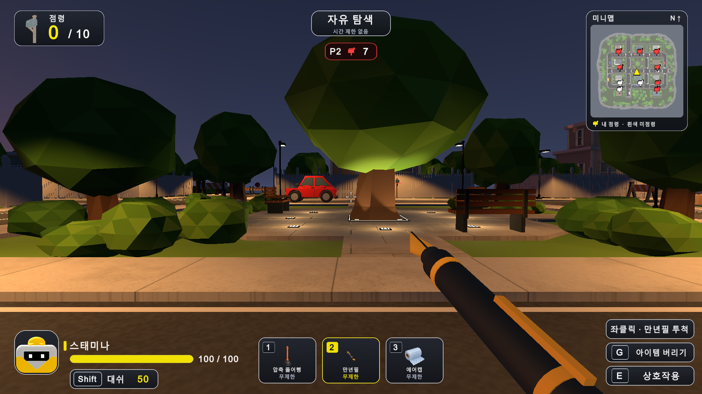

### 문제

기존 잉크 아이템을 던져 맞히는 방식으로 바꾸되, 뚫어뻥처럼 되돌아오는 동작이 아니라 총알처럼 날아가는 만년필이 필요했다.

### 원인과 배경

바닥 영역으로 잉크를 처리하는 기존 방식으로는 명확한 투사체와 직접 적중 대상을 표현하기 어려웠다.

### 사용한 방법

ID 9를 유지하면서 FountainPen으로 교체하고 검은 몸통과 금색 펜촉 모델, 실제 모델 아이콘을 연결했다. 기존 BrawlShot에 무중력 Rigidbody와 연속 충돌, SweepTest를 사용해 48m/s로 발사하고 첫 충돌에서 삭제한다. 사거리는 35m이며 복귀하지 않는다.

### 해결 결과

직접 맞은 플레이어의 화면만 4초간 잉크로 가린다. 이동과 점령 자체는 허용한다. 벽 앞 생성 가림과 고속 이동 경로를 검사하며 슬롯 변경이나 폐기 뒤에도 이미 발사한 펜은 유지된다.

### 확인 근거

Fountain Pen 검사 54개를 2026년 10월 15일 다시 통과했다. 실제 비행과 상대 및 본인 적중, 얇은 벽, 생성 위치 가림, 사거리, 복귀 없음이 포함된다.

구현 위치 [Assets/Gameplay/FountainPenCombat.cs](../../Assets/Gameplay/FountainPenCombat.cs) · [Assets/Gameplay/MonsterDeliveryPrototype.cs](../../Assets/Gameplay/MonsterDeliveryPrototype.cs) · [Assets/Editor/FountainPenSetup.cs](../../Assets/Editor/FountainPenSetup.cs)

## 05 잉크의 시야 차단과 적중 피드백 강화

요청 R10, R11 · 표시 범위와 적중 연출 개선

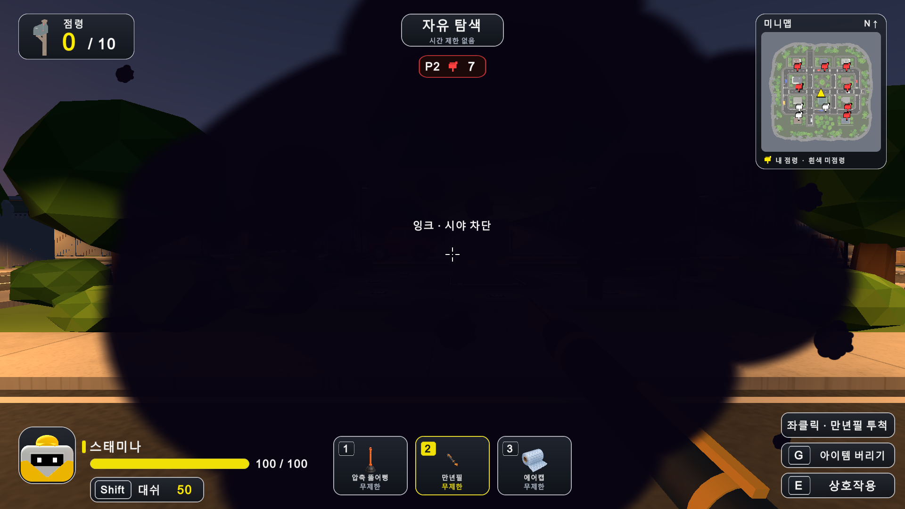

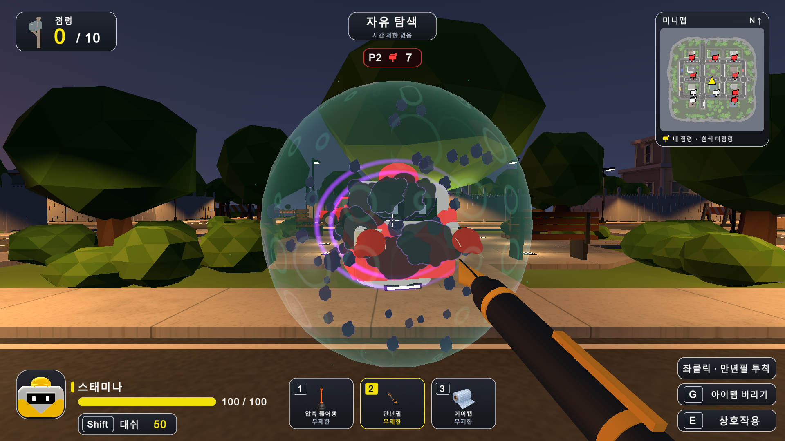

### 문제

잉크에 가려지는 범위가 좁았고, 맞힌 사람이 상대를 봤을 때 성공 여부를 알기 어려웠다.

### 원인과 배경

피격자의 화면 효과만으로는 공격자에게 결과가 전달되지 않는다. 작은 얼룩만 사용하면 시야 차단과 명중 피드백 모두 약해진다.

### 사용한 방법

화면 잉크 크기를 가로 1.06에서 1.48배, 세로 1.24에서 1.72배로 약 40% 넓혔다. 상대 적중에는 큰 잉크 방울 48개, 보라색 충격 고리 2개, 떠 있는 얼굴과 몸통을 따라가는 자국 7개를 추가했다.

### 해결 결과

피격자는 화면 중앙과 가장자리까지 넓게 가려지고, 공격자는 잉크 튐과 몸에 남은 자국으로 명중을 구별한다. 자국은 시야 차단과 같은 4초 동안 유지되고 마지막 0.65초에 사라진다.

### 확인 근거

54개 검사에서 실제 투사체 적중, 자국의 몸 추적, 반복 적중 시 시간 갱신, 에어캡에 막혔을 때 잉크 미표시와 종료 복구를 확인했다.

구현 위치 [Assets/Gameplay/FountainPenCombat.cs](../../Assets/Gameplay/FountainPenCombat.cs) · [Assets/Gameplay/FountainInkHit.cs](../../Assets/Gameplay/FountainInkHit.cs)

## 06 에어캡 방어를 공통 피격 경로로 통합하기

요청 R12, R13 · 결함 수정과 공통 구조 정리

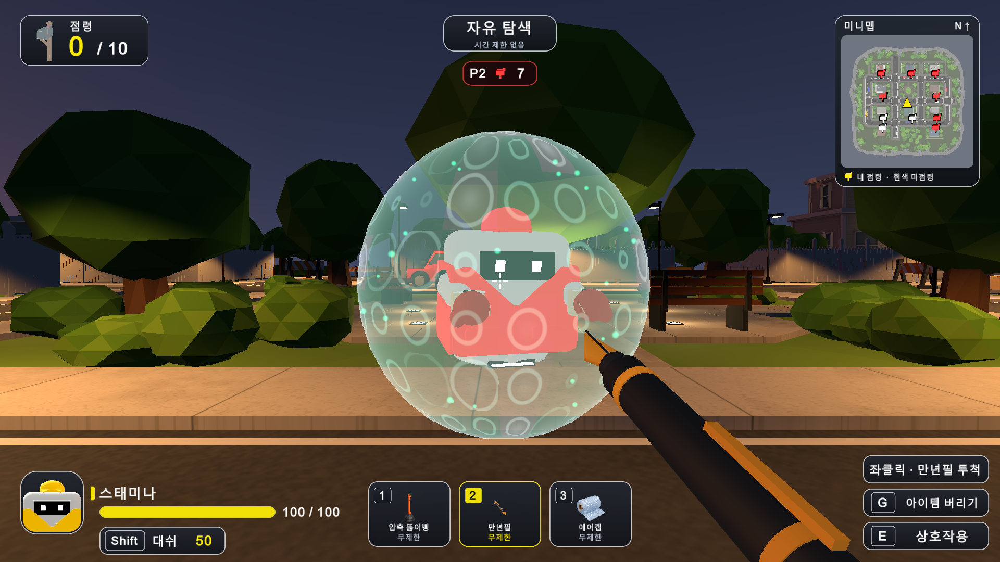

### 문제

에어캡을 사용해도 만년필 잉크가 들어왔다. 아이템마다 별도로 방어 코드를 넣으면 새로운 공격이 추가될 때 같은 누락이 반복될 수 있었다.

### 원인과 배경

만년필이 기존 Control의 방어 판정을 거치지 않고 visionBlockedUntil을 직접 기록해 보호막을 우회했다.

### 사용한 방법

DeliveryItemHit에 힘, 기절, 슬로우, 잉크 시간과 방어 가능 여부를 담았다. 모든 적중을 ApplyItemHit와 ReceiveHit로 전달하고 Ignored, Blocked, Applied 결과를 반환한다. 유효 효과 확인 뒤 방어를 먼저 처리하고, Applied일 때만 상태 변경과 해당 피격 연출을 보여 준다.

### 해결 결과

에어캡은 첫 유효 공격의 모든 효과를 한 번에 막고, 다음 공격은 정상 적용한다. 새 아이템도 같은 입력 구조를 사용하면 기본적으로 방어된다. 슬라임 바닥처럼 지형 위험은 shieldable false를 명시해 별도 정책을 표현한다.

### 확인 근거

만년필 54개와 에어캡 32개 재검증에서 실제 본인과 상대의 방어, 복합 효과 일괄 차단, 면역과 무효 타격의 보호막 미소비, 두 번째 적중을 확인했다. 검사 개수는 서로 다른 고유 사례 수의 합계로 해석하지 않는다.

구현 위치 [Assets/Gameplay/DeliveryItemHit.cs](../../Assets/Gameplay/DeliveryItemHit.cs) · [Assets/Gameplay/DeliveryItemState.cs](../../Assets/Gameplay/DeliveryItemState.cs) · [Assets/Gameplay/MonsterDeliveryPrototype.cs](../../Assets/Gameplay/MonsterDeliveryPrototype.cs)

## 07 벽과 바닥에 검은 잉크를 남기고 지우기

요청 R14 · 표면 적중 효과 구현

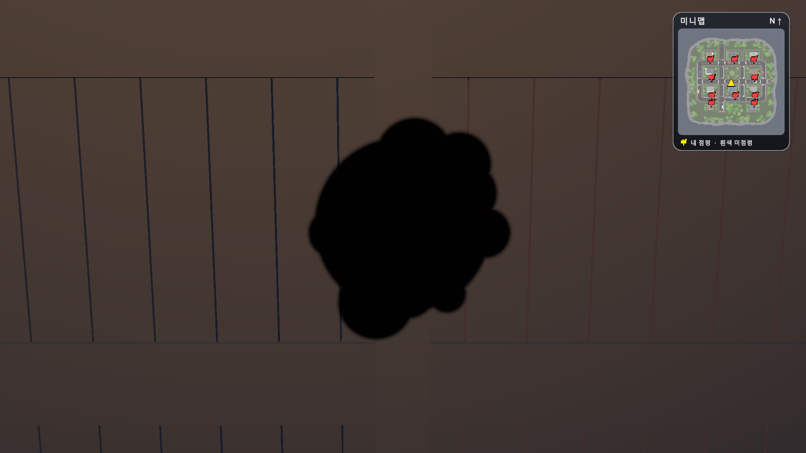

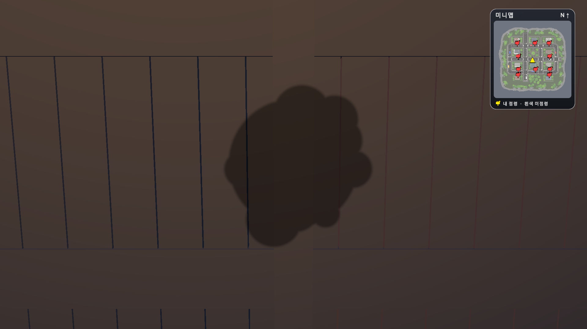

### 문제

플레이어가 아닌 곳에 맞았을 때도 검은 잉크가 묻고, 1초 뒤부터 서서히 없어지는 흔적이 필요했다.

### 원인과 배경

플레이어의 화면 잉크와 환경 표면 자국은 목적과 수명이 다르다. 평면 이미지를 단순히 띄우면 경사나 둥근 소품에 들뜨거나 도로 차선과 겹쳐 깜빡일 수 있다.

### 사용한 방법

실제 충돌점과 법선을 전달하고 SurfaceInkMark가 Collider.Raycast로 17×17 격자를 표면에 맞췄다. 유효 삼각형만 그리며 표면에서 12mm 띄우고 대상의 자식으로 붙여 이동을 따라가게 했다.

### 해결 결과

검은 자국을 처음 1초 유지한 뒤 1초 동안 부드럽게 투명하게 만든다. 총 2초 뒤 오브젝트와 런타임 메시를 제거한다. 플레이어 적중과 에어캡 방어에는 환경 자국을 만들지 않는다.

### 확인 근거

Surface Ink 검사 26개를 2026년 10월 15일 다시 통과했다. 벽, 바닥, 경사, 곡면, 이동 표면과 유지 및 페이드, 만료를 확인한다.

구현 위치 [Assets/Gameplay/SurfaceInkMark.cs](../../Assets/Gameplay/SurfaceInkMark.cs) · [Assets/Gameplay/FountainPenCombat.cs](../../Assets/Gameplay/FountainPenCombat.cs)

## 08 뚫어뻥 흡착컵 전체 크기로 명중 판정하기

요청 R15 · 충돌 판정 결함 수정

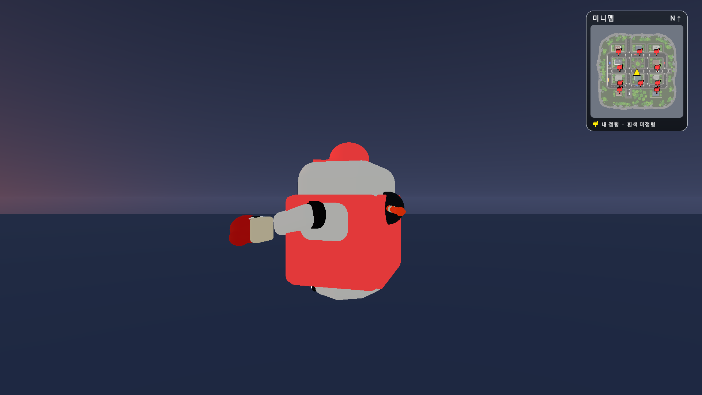

### 문제

뚫어뻥 흡착컵 끝이 플레이어 몸에 걸려 보이는데도 적중하지 않아 상대를 당기지 못했다.

### 원인과 배경

루트 중심선의 얇은 Raycast는 컵의 위치와 폭을 포함하지 못했다. 네이티브 캐릭터 쿼리에서 관찰한 반경 약 0.44m와 몸 표시 반경 0.55m 차이도 가장자리 누락을 만들었다.

### 사용한 방법

실제 MeshFilter bounds에서 흡착면과 컵 반경 약 0.141m를 구하고 2cm 여유를 더했다. 환경은 시작 OverlapSphere와 SphereCastAll, 상대는 CharacterController bounds 전체 수직 캡슐과 컵 구의 정확한 교차로 검사한다. 가장 가까운 접촉 한 번만 처리하고 같은 거리에서는 벽을 우선한다.

### 해결 결과

좌우와 상하 가장자리, 시작부터 겹친 상대도 컵 범위에 걸리면 명중한다. 기존 공통 방어 경로를 통과한 상대를 현재 내 앞 약 1.6m까지 당기며 몸 충돌로 벽 통과를 막는다. 이 경로는 이후 뿅망치와 SweepItemPath로 공유했다.

### 확인 근거

Plunger 검사 92개를 2026년 10월 15일 다시 통과했다. 가장자리 적중, 가까운 벽과 얇은 장애물, 이동 상대, 에어캡, 저항, 당겨진 최종 위치가 포함된다. 정지 캡처만으로 판정 폭 수정이 입증되는 것은 아니며 검사 로그가 그 근거다.

구현 위치 [Assets/Gameplay/PlungerCombat.cs](../../Assets/Gameplay/PlungerCombat.cs) · [Assets/Editor/PlungerEffectsCheck.cs](../../Assets/Editor/PlungerEffectsCheck.cs)

## 09 박스 테이프를 슬라임 투척과 감속으로 교체하기

요청 R16 · 아이템 요구 변경과 상태 표시

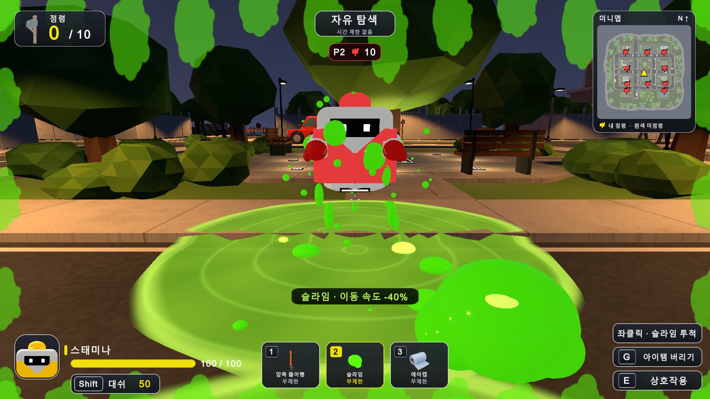

### 문제

박스 테이프 대신 던지는 슬라임으로 상대를 느리게 만들고, 느려진 상태를 분명히 보여 줄 필요가 있었다.

### 원인과 배경

기존 바닥 슬로우만으로는 투척물과 직접 적중, 피격자 및 관찰자에게 필요한 상태 표시가 부족했다.

### 사용한 방법

ID 4를 Slime으로 교체하고 중력으로 날아가는 젤 모델을 연결했다. 직접 타격은 공통 피격 경로로 3초 감속, 바닥은 반경 3m와 5초 수명으로 만들었다. 상대 몸통에는 코팅 6개와 흐르는 방울 10개, 본인 화면에는 초록 테두리와 감속 문구를 표시한다.

### 해결 결과

이동 속도 40% 감소가 눈에 보인다. 바닥을 벗어나면 0.3초 뒤 회복하며 사용자도 밟으면 느려진다. Max로 종료 시간을 갱신해 짧은 바닥 갱신이 긴 직격 감속을 줄이지 않게 했다.

### 확인 근거

Slime 검사 53개에서 본인과 상대 발사, 직격 방어와 바닥 정책, 벽 및 층 구분, 범위, 이탈과 만료를 확인했다. 직접 타격은 에어캡이 막고, 방어된 직격은 즉시 바닥을 생성하지 않는다.

구현 위치 [Assets/Gameplay/SlimeCombat.cs](../../Assets/Gameplay/SlimeCombat.cs) · [Assets/Gameplay/SlimeSlowEffect.cs](../../Assets/Gameplay/SlimeSlowEffect.cs) · [Assets/Gameplay/SlimePuddle.cs](../../Assets/Gameplay/SlimePuddle.cs) · [Assets/Gameplay/DeliveryItemState.cs](../../Assets/Gameplay/DeliveryItemState.cs)

## 10 슬라임이 공중과 가로등에서 사라지는 현상 수정

요청 R17 · 비행 수명과 충돌 결과 결함 수정

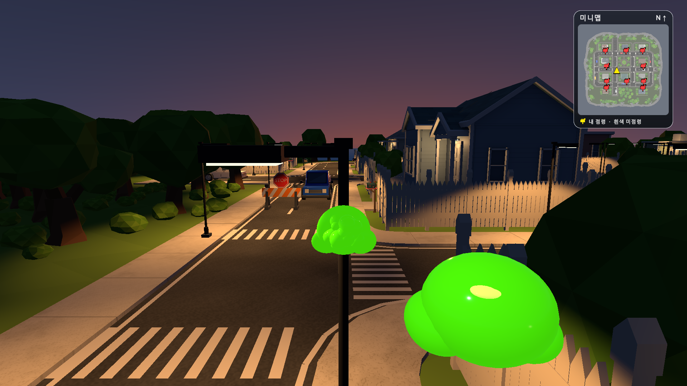

### 문제

높게 던진 슬라임이 착지 전에 사라지고, 높은 가로등에 맞으면 짧게 터진 뒤 아무것도 남지 않았다.

### 원인과 배경

공유 BrawlShot의 3초 삭제 타이머와 Slime의 40m 제한이 중력 비행을 중간에 끊었다. 충돌 뒤 아래 지면을 4m까지만 찾아 높은 위치에서는 웅덩이를 만들지 못했다.

### 사용한 방법

슬라임의 3초와 40m 제한을 제거해 실제 충돌까지 날아가게 하고, 맵 아래 Y -20m 미만만 정리했다. 하향 지면 탐색 거리 제한을 없애 가장 가까운 유효 지면을 찾고, 충돌 표면에는 납작한 젤 자국을 5초 남겼다.

### 해결 결과

높은 투척도 내려와 실제 지면에서 터지고, 가로등에는 초록 자국과 아래쪽 웅덩이가 남는다. 만년필의 기존 35m와 3초 규칙은 별도로 유지한다.

### 확인 근거

53개 검사에 3.2초 뒤 공중 생존과 실제 착지, 40m를 넘는 대각선 착지, 약 9m 높이 기둥, 실제 맵 StreetLamp 적중, 맵 아래 정리가 포함된다.

구현 위치 [Assets/Gameplay/SlimeCombat.cs](../../Assets/Gameplay/SlimeCombat.cs) · [Assets/Gameplay/MonsterDeliveryPrototype.cs](../../Assets/Gameplay/MonsterDeliveryPrototype.cs)

## 11 확성기를 근접 기절 뿅망치로 교체하기

요청 R18 · 아이템 요구 변경

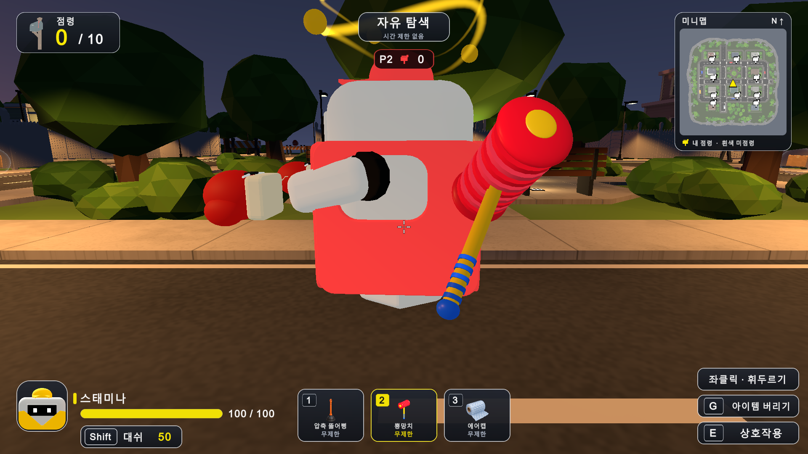

### 문제

확성기 대신 가까운 적을 때려 기절시키는 근접 뿅망치가 필요했다.

### 원인과 배경

전방 광역 기절을 예약하던 hornAt 처리와 확성기 모델로는 실제 휘두르기와 한 명 적중이라는 요구를 표현하지 못했다.

### 사용한 방법

ID 3을 ToyHammer로 교체하고 고무 주름 머리와 손잡이 모델을 만들었다. 준비 0.18초, 동작 0.48초, 재사용 0.75초로 타격 순간의 가장 가까운 적 한 명만 공통 피격 경로에 전달한다. 머리 폭과 벽 검사는 뚫어뻥의 SweepItemPath를 재사용한다.

### 해결 결과

적중한 상대가 1.2초 기절해 이동과 행동, 점령을 멈춘다. 머리 위 노란 고리 2개와 점 4개가 돌아가며 기절을 표시한다. 에어캡 방어와 기절 뒤 2초 면역도 같은 상태 경로로 처리한다.

### 확인 근거

최종 Toy Hammer 검사 36개에서 타격 지연, 일회 적중, 벽, 범위, 가장자리, NPC 이동 정지, 에어캡과 면역, 준비 취소, 폐기, 두 시점을 확인한다. 초기 사거리 2.5m는 다음 조정에서 3.5m로 확대했다.

구현 위치 [Assets/Gameplay/ToyHammerCombat.cs](../../Assets/Gameplay/ToyHammerCombat.cs) · [Assets/Gameplay/DeliveryStunEffect.cs](../../Assets/Gameplay/DeliveryStunEffect.cs) · [Assets/Editor/ToyHammerSetup.cs](../../Assets/Editor/ToyHammerSetup.cs)

## 12 뿅망치 타격면 방향과 사거리 조정

요청 R19 · 장착 방향과 수치 조정

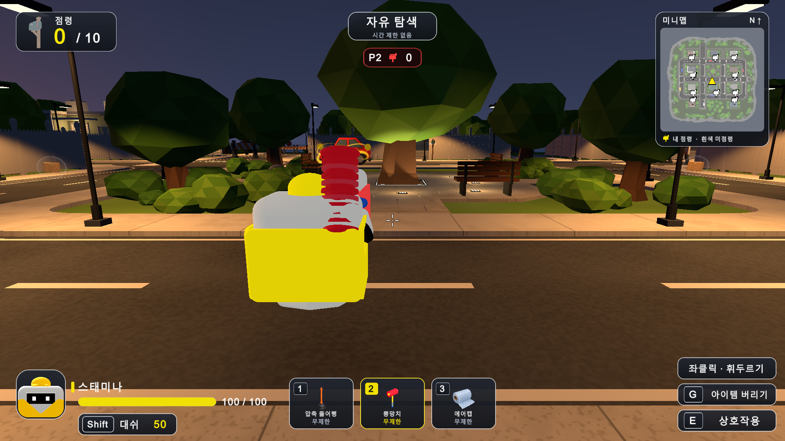

### 문제

망치의 때리는 면이 좌우를 향해 옆면으로 치는 것처럼 보였고 사거리가 짧게 느껴졌다.

### 원인과 배경

기본 모델의 두 타격면 축이 로컬 X축에 놓여 장착 시 본인과 상대를 향하지 않았다.

### 사용한 방법

손잡이를 바꾸지 않고 머리 부품만 HammerHead 자식으로 묶어 Y축 90도로 돌렸다. 타격면은 앞뒤를 향하고 기존 준비와 내리치기를 유지한다. HammerRange를 2.5m에서 3.5m로 40% 늘렸다.

### 해결 결과

1인칭과 3인칭 모두 양쪽 타격면이 본인 및 상대 방향과 정렬된다. 기존보다 먼 상대가 맞으며 머리 반경 0.32m, 기절 1.2초와 벽 및 보호막 정책은 유지한다.

### 확인 근거

36개 검사에는 두 시점의 타격면 축 확인, 이전 범위를 넘는 적중과 바깥 제외가 추가되어 있다. 적 중심 거리와 스윕 길이는 몸 반경 때문에 다르므로 수치를 같은 의미로 혼용하지 않는다.

구현 위치 [Assets/Editor/ToyHammerSetup.cs](../../Assets/Editor/ToyHammerSetup.cs) · [Assets/Gameplay/ToyHammerCombat.cs](../../Assets/Gameplay/ToyHammerCombat.cs) · [Assets/Editor/ToyHammerEffectsCheck.cs](../../Assets/Editor/ToyHammerEffectsCheck.cs)

## 13 망치 손잡이와 화면 배치 및 HUD 크기 조정

요청 R20 · 모델 비율과 UI 배치 조정

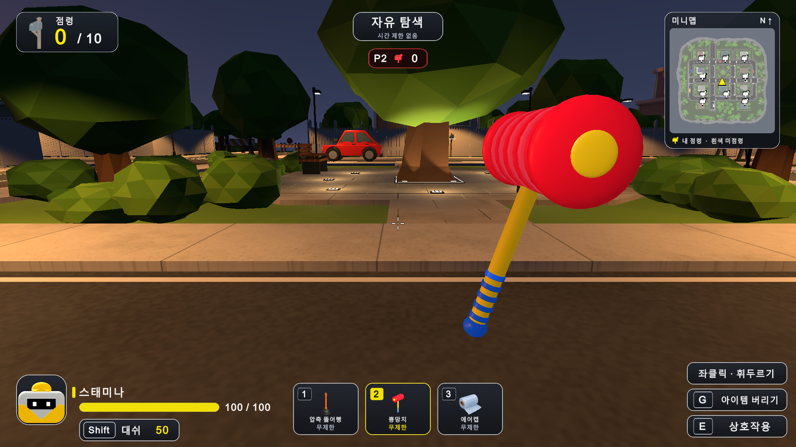

### 문제

손잡이가 짧고 망치가 화면 아래에 놓여 있었다. 왼쪽 점령 패널과 오른쪽 미니맵은 차지하는 면적을 줄일 필요가 있었다.

### 원인과 배경

짧은 손잡이와 낮은 1인칭 장착 위치가 결합되어 머리만 두드러졌다. 모델 높이만 올리면 미니맵과 겹치는 추가 문제가 생겼다.

### 사용한 방법

손잡이를 0.54m에서 0.81m로 1.5배 늘리고 머리 중심 Y를 0.57m에서 0.84m로 옮겼다. 장착 Y는 -0.4m에서 -0.25m로 올리고 X를 0.22m로 안쪽 보정했다. 점령 패널은 310×124에서 248×99, 미니맵은 350×414에서 280×332로 약 20% 줄였다.

### 해결 결과

긴 손잡이가 보이고 높아진 망치가 미니맵과 겹치지 않는다. 제목과 수치, 지도 마커와 범례도 함께 줄였다. 지도 원본 512px, 좌표, 점령 데이터와 전투 수치는 유지한다.

### 확인 근거

실제 Game View에서 조준점과 UI 겹침, 휘두르기, 아이콘 프레이밍을 확인하고 기존 36개 검사를 다시 통과했다. 표기 크기는 1920×1080 기준이다.

구현 위치 [Assets/Editor/ToyHammerSetup.cs](../../Assets/Editor/ToyHammerSetup.cs) · [Assets/Gameplay/MonsterDeliveryHUD.cs](../../Assets/Gameplay/MonsterDeliveryHUD.cs) · [Assets/Gameplay/DeliveryMinimap.cs](../../Assets/Gameplay/DeliveryMinimap.cs)

## 현재 아이템 목록

| 아이템 | 역할 | 범위 |
|---|---|---|
| 복싱 글러브 | 교대 밀치기와 넉백 | 기존 프로젝트 기록 |
| 압축 뚫어뻥 | 15m 투척과 당김 및 컵 폭 판정 | 상세 08 |
| 뿅망치 | 3.5m 스윕과 1.2초 기절 | 상세 11부터 13 |
| 슬라임 | 투척과 이동 속도 40% 감소 | 상세 09와 10 |
| 무선 선풍기 | 전방 밀기 설계 | 효과 활성화 보류 |
| 러닝화 | 5초 동안 이동 속도 50% 증가 | 상세 01과 02 |
| 에어캡 | 8초 안의 유효 공격 한 번 방어 | 상세 03과 06 |
| 작업용 장갑 | 선택 착용 중 점령 3초를 1.5초로 단축 | 기존 프로젝트 기록 |
| 만년필 | 48m/s 직선 투척과 4초 시야 차단 | 상세 04부터 07 |

## 추가 프로젝트 기록

현재 대화보다 앞선 프로젝트 기록에는 복싱 글러브의 좌우 교대 동작과 밀침 거리 약 5.4m에서 16.2m로 강화, 작업용 장갑의 점령 시간 3초에서 1.5초로 단축, 반복 사용 뒤 아이템 유지가 있다. 이 내용은 대화의 20개 요청과 구분해 추가 프로젝트 기록으로 남긴다. 당시 장갑 검사 52개 통과 기록은 NEXT_SESSION과 보존된 로그에 있으며 오늘 다시 실행한 검사군에는 포함하지 않았다.

## 재실행 검사 결과

- 러닝화 29개 통과 2026-10-15 [running-shoes-effects-check-20261013.txt](evidence/running-shoes-effects-check-20261013.txt)
- 에어캡 32개 통과 2026-10-15 [bubble-wrap-effects-check-20261013.txt](evidence/bubble-wrap-effects-check-20261013.txt)
- 만년필과 공통 피격 54개 통과 2026-10-15 [fountain-pen-check-20261013.txt](evidence/fountain-pen-check-20261013.txt)
- 표면 잉크 26개 통과 2026-10-15 [surface-ink-check-20261013.txt](evidence/surface-ink-check-20261013.txt)
- 뚫어뻥 92개 통과 2026-10-15 [plunger-cup-volume-check-20261014.txt](evidence/plunger-cup-volume-check-20261014.txt)
- 슬라임 53개 통과 2026-10-15 [slime-check-20261014.txt](evidence/slime-check-20261014.txt)
- 뿅망치 36개 통과 2026-10-15 [toy-hammer-check-20261014.txt](evidence/toy-hammer-check-20261014.txt)

현재 테스트는 로컬 Unity 프로토타입이다. 온라인 동기화와 모든 봇의 아이템 자동 사용까지 완료했다는 뜻은 아니다. 검사는 서로 겹치는 사례를 포함하므로 검사군 개수를 합쳐 고유 기능 수나 오류 수로 해석하지 않는다.

## 파일 안내

index.html은 전체 이미지와 본문을 함께 보여 준다. Word 원본은 ItemTroubleshooting_20261015.docx다. requests.csv는 요청 대조표, image_manifest.json은 원본 경로와 촬영 구분 및 이미지 해시다. source 폴더의 생성기를 사용하면 문서와 열람본을 다시 만들 수 있다.